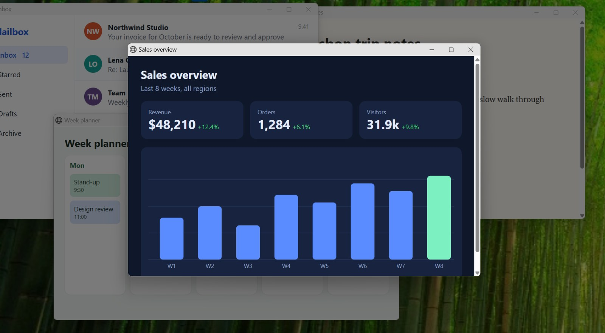

# Useful apps. Built with AI. Shared for free.

Small Windows tools that make everyday computer work easier, plus reusable AI skills and Claude Code mods. Download a finished app or learn how to build your own with the guides, prompts, and source available for each project.

Made by Pete Carter. Learning, building, and sharing AI with everyone. [Follow the builds on X](https://x.com/PeteC_19).

[Windows apps](#windows-apps) · [Agent Skills](#agent-skills) · [Claude Code mods](#claude-code-mods) · [Help and feedback](#help-and-feedback)

## Spotlight

**Spotlight: focus on the window you're using.** Dim the surrounding desktop while you work. Click a different window and Spotlight follows it. Free for Windows. Runs locally. No account required.



- **[Download Spotlight for Windows](https://github.com/petercarter19-hue/Apps/releases/tag/spotlight-v1.3.0)** (Spotlight 1.3.0, the installer `Spotlight-Setup-1.3.0.exe`, about 44 MB)
- **[Build Spotlight yourself](spotlight/KIT.md)** with an AI app, no coding
- **[View source](spotlight/)**

## Windows apps

Each app has its own download page (a release for that app only) and its own folder with the source. The installers and programs are not code-signed yet, so Windows may show a "Windows protected your PC" box: choose **More info**, then **Run anyway**.

| App | What it helps with | Download | Build it yourself |
| --- | --- | --- | --- |
| [Spotlight](spotlight/) | Dims everything on every screen except the window you are working in, and the light follows the window you click. Windows 11. | [Spotlight 1.3.0 installer](https://github.com/petercarter19-hue/Apps/releases/tag/spotlight-v1.3.0) | [Build kit](spotlight/KIT.md) |
| [Chirpy](chirpy/) | Hold Left Alt, speak, and place the words where your cursor is. Speech is recognized on your PC; English only. Windows 11. | [Chirpy 1.0.0 installer](https://github.com/petercarter19-hue/Apps/releases/tag/chirpy-v1.0.0) (about 500 MB, the speech model is included) | [Source and build steps](chirpy/README.md#build-it-yourself) (no AI build kit yet) |
| [Glance](glance/) | A memory meter by the clock: hover it to see which apps use the most memory, and end a greedy one in two clicks. Windows 10 or 11. | [Glance 1.1.1](https://github.com/petercarter19-hue/Apps/releases/tag/glance-v1.1.1) | [Build kit](glance/KIT.md) |
| [PhotoTwins](phototwins/) | Finds the same photo saved more than once, shows each group side by side with the best copy starred, and clears the extras safely, to the Recycle Bin with Undo. Windows 10 or 11. | [PhotoTwins 1.0.0](https://github.com/petercarter19-hue/Apps/releases/tag/phototwins-v1.0.0) | [Build kit](phototwins/KIT.md) |

All four are free, open source (MIT) and need no account. Each app's page says what it reads, writes and keeps private.

## Agent Skills

A skill is a set of reusable instructions that helps an AI repeat a task consistently. You add one by copying its folder into your AI app's skills folder (Claude Code, Codex and other apps that read Agent Skills), then ask for the job in plain words. More in [skills](skills/).

| Skill | What it helps with | Instructions |
| --- | --- | --- |
| [skill-maker](skills/skill-maker/) | Turn the work you do with AI into skills it remembers | [Guide](skills/skill-maker/README.md) · [SKILL.md](skills/skill-maker/SKILL.md) |
| [status-update](skills/status-update/) | Get clear, same-every-time status updates from your AI | [Guide](skills/status-update/README.md) · [SKILL.md](skills/status-update/SKILL.md) |

## Claude Code mods

Small add-ons that change how Claude Code looks and behaves. You don't write any code.

| Mod | What it does |
| --- | --- |
| [context-meter](mods/context-meter/) | Shows how full the conversation's context window is and your 5-hour limit with the time left, in the status line, and what fills the window and where tokens go in a side panel (`/meter panel`). `/meter` prints the report. Includes a Forest color theme. |
| [mood-strip](mods/mood-strip/) | A full-width colored strip above the prompt that shows how the session is going: what Claude is doing or thinking right now, a trail of its last steps, and the plan's progress as dots. `/mood demo` plays made-up scenes. Includes a [build kit](mods/mood-strip/KIT.md). |
| [done-ping](mods/done-ping/) | A notification and a chime when Claude finishes a long task. `/done-ping` sends a test. |
| [todo-panel](mods/todo-panel/) | A to-do list in a side panel that remembers between sessions. `/todo <text>` adds, `/todo done <n>` ticks off, or ask Claude to add things. |

### Install a mod

At the prompt of a Claude Code terminal session, add this marketplace once (it is named `apps`):

```
/plugin marketplace add petercarter19-hue/apps
```

Then install the mods you want:

```
/plugin install context-meter@apps
/plugin install mood-strip@apps
/plugin install done-ping@apps
/plugin install todo-panel@apps
```

In the Claude desktop app (Code tab, a local session): click + next to the prompt box, then Plugins, Add marketplace with `petercarter19-hue/apps`, then Add plugin and pick each mod you want.

To use the Forest colors in a terminal, run `/theme` and pick **Forest**.

## Help and feedback

Something not working, or an idea? [Open an issue](https://github.com/petercarter19-hue/Apps/issues/new). Follow the builds on X: [@PeteC_19](https://x.com/PeteC_19).

## License

[MIT](LICENSE): use it, change it, share it. Chirpy's third-party components and speech model have their own licenses, listed in [chirpy/THIRD-PARTY-NOTICES.md](chirpy/THIRD-PARTY-NOTICES.md).
