# Build your own Chirpy

Hold a key, talk, and your words are typed wherever your cursor is: in email, documents, chat. Double-tap the key and talk hands-free. Select a word it got wrong, press one shortcut, type the fix, and it spells that word right from then on. A free speech model turns your voice into text on your own computer: no account, no API key, no online service. It types English. You don't write any code. You paste one message to the AI, try what it builds, and tell it what happened.

| Time | Messages | Cost | Coding |
|:-:|:-:|:-:|:-:|
| **8 to 12 h** over a few days, mostly waiting | **About 8** short messages to send | **$0** beyond your AI plan | **No code**: you write none of it |

> [!NOTE]
> **Made with Claude Code, works with any AI app.** We built ours with Claude Code. You can use any AI coding app you like, for example Antigravity, Codex or Cursor: the messages and steps are the same. Section 3 shows where to paste the message in each.

Prefer to read it on paper? There is a printable [PDF of this kit](docs/build-it-yourself-kit.pdf).

## 1. What you'll end up with

- **Dictation anywhere.** Hold <kbd>Left Alt</kbd>, talk, let go. Your words are typed where the cursor is, with punctuation and capitals. Dictate again into the same window and it adds the space for you.
- **Hands-free.** Double-tap the key and keep talking; tap once to stop. <kbd>Esc</kbd> cancels.
- **Teach a word.** Select a word it got wrong, hold <kbd>Shift</kbd> and tap <kbd>Left Alt</kbd>, type the fix. It remembers.
- **A real app.** Home, History, Words & fixes and Settings, light and dark, an icon by the clock, and a small glowing light while it listens.
- **Private by design.** Your voice is turned into text on your PC, and your history stays there until you clear it. One honest catch: to type, it briefly uses the Windows clipboard (section 9).
- **A real installer** you can hand to a friend.

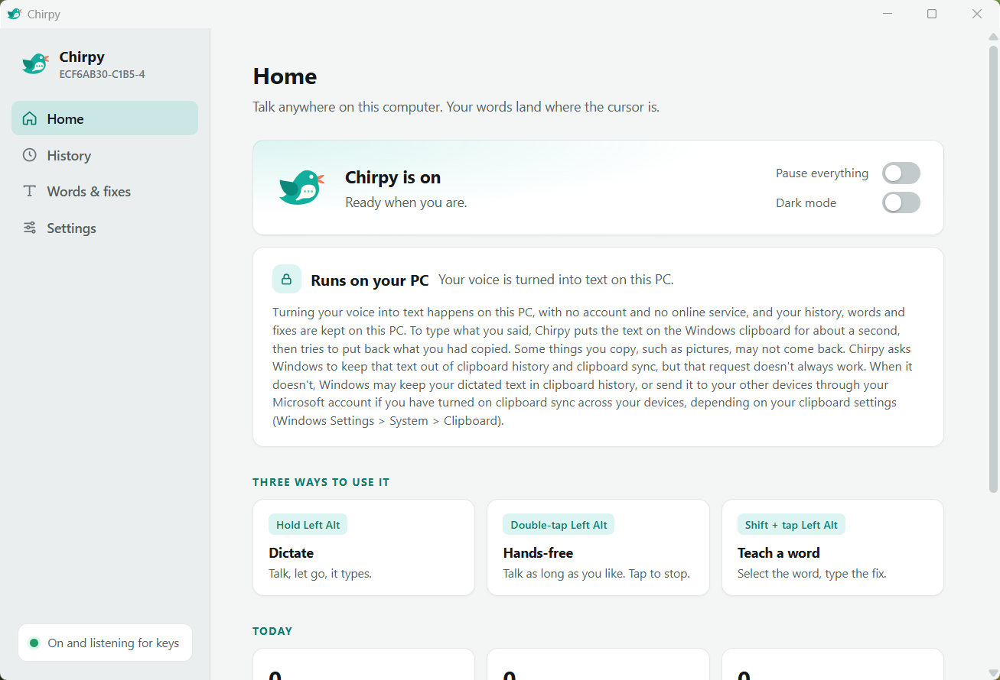

*Ours. Home says it's on, says plainly what happens on your PC, and shows your keys.*

## 2. What you need

- **A Windows 10 or 11 PC** with about 5 GB free while you build, and a microphone (a headset is best; a laptop mic is fine).
- **An AI app that can build on your computer:** one that can create files and run programs, not just chat, for example Antigravity, Claude Code, Codex or Cursor. Your AI plan is the only thing you pay for.
- **Windows Sandbox (recommended):** a free, throwaway copy of Windows inside Windows, where the AI tests installers and key presses without touching your real PC. It comes with Windows Pro; the AI turns it on for you (one restart). On Windows Home, skip it: the message covers that.

| Part of the app | What runs it | Cost |
|---|---|---|
| Voice to text | NVIDIA's free Parakeet speech model, on your PC (about 630 MB) | $0 |
| The window | Microsoft Edge WebView2, already in Windows | $0 |
| Keys, tray, light, history | Free tools the AI sets up | $0 |
| The installer | Inno Setup, a free installer maker | $0 |

> [!NOTE]
> **Good to know.** No credit card, API key or cloud account, ever. The finished app is about 840 MB because it carries its own Python and the speech model, so your friends install nothing else.

## 3. Get set up (10 minutes)

1. **Install your AI app** and sign in. Use one that can work on your computer, not just chat.
2. **Make an empty folder** for your app, for example `C:\MyVoiceApp` (short, no spaces, not in OneDrive).
3. **Open that folder in your AI app**, in the part that can work on your computer.
4. **When it asks permission** to run something or download a file, read the one-line description and allow it for this folder. That's how it installs things for you.

Where to paste the message in some popular AI apps. Their menus change often, so look for the same idea if yours looks different.

| If you use | Open your folder | Paste the message into |
|---|---|---|
| **Antigravity** | File > Open Folder | The agent chat panel |
| **Claude Code** | In the Claude desktop app, open the Code tab and pick the folder; or type `claude` in a terminal inside it | The chat box |
| **Codex** | In the Codex app, add the folder as a project; or type `codex` in a terminal inside it | The chat box |
| **Cursor** | File > Open Folder | The Agent chat in that window |

## 4. Choose your options

Write your answers into the [brackets] of the message in the next section. If you're unsure, keep the suggestion.

| Choice | Suggested | Notes |
|---|---|---|
| Your app's name | Chirpy | Anything you like. |
| Key to hold | Left Alt | Alt+Tab and other shortcuts keep working. Teach is Shift + this key. |
| Words it must spell right | Your name, your company | You can add more in the app. |
| The look | Calm teal, light first | Say anything: "warm orange", "very plain". |
| Name on the license | Your app's name | Goes in the free MIT license's copyright line. |

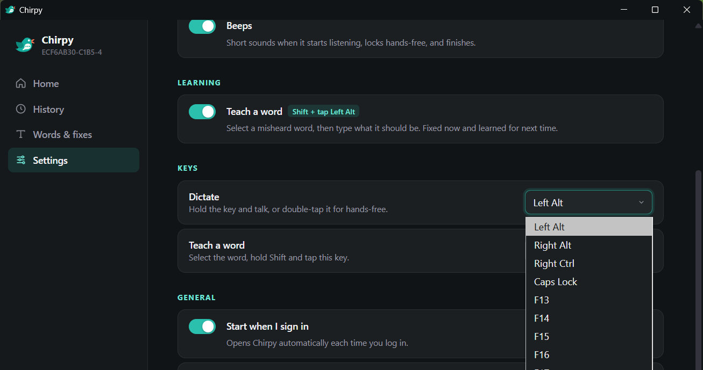

*You can change keys any time in Settings, from a short list. Changes apply at once.*

## 5. The one message that builds it

Change the [brackets] and paste it into your AI app. It answers every question up front, and it has our build lessons baked in, so the AI takes the shortest route we know.

**Copy this and paste it to your AI:**

```text
I want to build a free voice-typing app for Windows called [Chirpy]: hold a key, talk, and my words are typed where my cursor is. I'm not technical and I've never coded. Build it step by step, show me something working after each step, and test what you can yourself before asking me.

FIRST
- Check my PC (Windows edition, disk space, microphone, Windows Sandbox). Turn Sandbox on if it's there (I'll restart). On Windows Home, test in a throwaway folder and leave the installer try to me.
- Write PLAN.md with the steps below and a short GOOD-ENOUGH LIST in plain words: my files are never lost or broken, two quick changes both stick, starting the app twice never breaks anything, and no message says something the code doesn't do. Every later check is graded against that list.

WHAT IT DOES
- Hold [Left Alt], talk, let go: typed where my cursor is. Double-tap for hands-free, tap to stop, Esc cancels. Alt+Tab never starts it.
- English only, American spelling. A second dictation into the same window within 2 minutes starts with a space (and a capital after . ? !).
- Teach: I select a wrong word, hold Shift and tap [Left Alt], type the fix, press Enter. Never copy text in a terminal or code editor. Words it must spell right: [my name, my company].
- A window with Home, History (search, Copy, Clear history), Words & fixes and Settings (a switch per feature, keys from a short list); a dark/light switch on Home; an icon by the clock (Open, Settings, Pause, Quit); a small light while it listens. Look: [calm teal, light first].
- Plain messages: no microphone, a change that couldn't be saved, or an app that can't start each say what to do, in one sentence.

DECISIONS ALREADY MADE
- Speech: the free local NVIDIA Parakeet TDT 0.6B v2 model (int8, ONNX) with onnx-asr, on the CPU. Credit NVIDIA in a notices file that lists every part and its license. My own code is MIT, "Copyright (c) [year] [Chirpy]".
- Typing: paste through the clipboard for about a second, then put my clipboard back. Say honestly on Home that Windows clipboard history or sync may still see it.
- Saving: ONE careful way to save every file of mine (temporary copy, then swap; never write a file you couldn't read). A second start only reads.
- Only one voice app may listen to the keys at a time: refuse to start, or quit, and say why.
- Package: its own Python and the model, per user, no administrator. Installer: Inno Setup, unsigned, license page first, an UNCHECKED "Start when I sign in", and an uninstaller that asks whether to keep my words and history.

HOW TO WORK WITH ME
- Plain English, short answers. Don't ask me technical questions.
- Test installs, uninstalls and key presses ONLY in Windows Sandbox, never with real keys or clicks on my screen. Any test that starts the app stops it by its exact process ID.
- Run installers from PowerShell. Ask before deleting anything of mine.
- Promise only what the code does. If the same fix fails three times, stop and give me the simpler way forward.

STEPS: 1 Talk and it types  2 Teach a word  3 The app  4 The installer  5 A second opinion
Start with step 1.
```

> [!TIP]
> **Want it all in one go?** Change the last line to: "Build all the steps without stopping. Test each one yourself, and only stop when everything works or you need a decision only I can make." Then come back later.

> [!NOTE]
> **Want to go your own way?** This is the route we know works, not the only one. Tell the AI "I'd like to do [your idea] instead," and ask which lines above still apply. Keep three: test in the Sandbox, save your files carefully, and write the good-enough list first.

## 6. Try each step

After each step, try it with your real voice. If it works, say "Works. Next step." If not, say what you did and what happened.

### Step 1. Talk and it types (2 to 3 h)

Open Notepad, hold <kbd>Left Alt</kbd>: "Please send the report to the whole team by Friday." Let go. Then double-tap, say two sentences, tap to stop. Check Alt+Tab still works.

If the AI restarted your PC to turn on Sandbox: open your AI app, open the same folder, and say "I restarted. Carry on with PLAN.md."

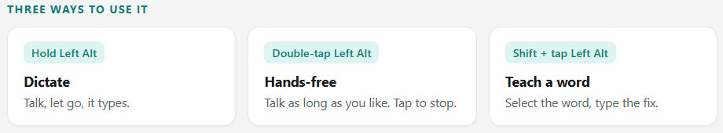

*Home lists the three ways to use it, each with its key.*

### Step 2. Teach a word (45 to 60 min)

Say "Please email Zoltan Szabo today." Double-click the name it got wrong, hold <kbd>Shift</kbd> and tap <kbd>Left Alt</kbd>, type the right spelling, press Enter. Say it again: it comes out right.

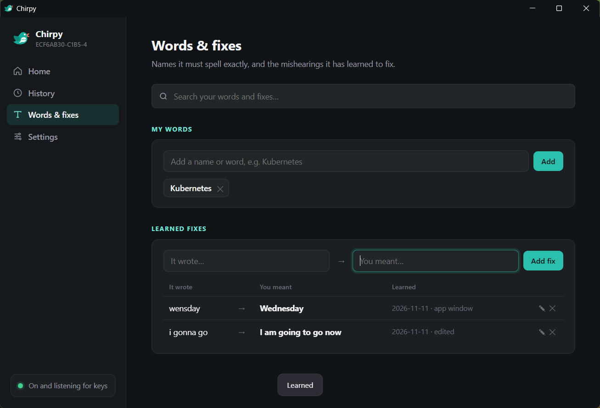

*Words & fixes: the words it must spell, and the fixes it learned. (Made-up words.)*

### Step 3. The app (90 to 120 min)

Open the app. Click all four pages, flip Dark mode on Home, choose another key in Settings and use it straight away. Close the window: the icon by the clock stays.

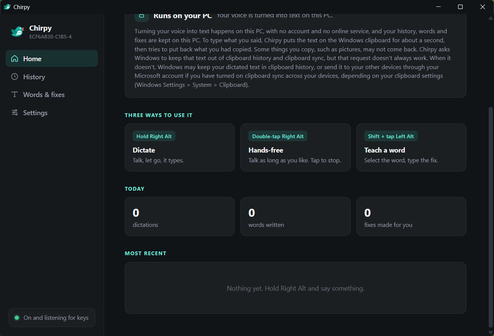

*Home in the dark look: today's counts and your latest dictations.*

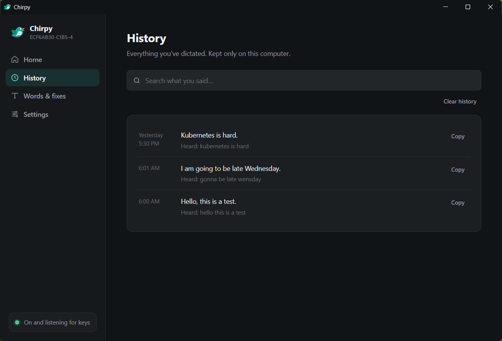

*History: search it, copy a line again, or clear it all. (Made-up entries.)*

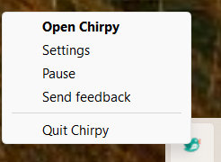

*Right-click the icon by the clock (it may hide under the ^ arrow). Ours also has Send feedback (section 7).*

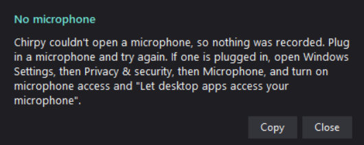

*No microphone? It tells you what to do.*

### Step 4. The installer (2.5 to 3.5 h)

Say: "Run the installer in the Sandbox and show me a picture of every page, then the uninstall question." Check every sentence is true. Then: "Where is Setup.exe? I'll install it on my PC now." If Windows warns, choose *More info*, then *Run anyway*: that's normal for a free, unsigned app. (On Windows Home: say "Where is Setup.exe?", run it yourself and check each page against the pictures.)

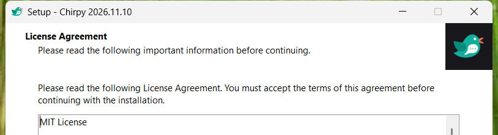

*The first page is your app's free license.*

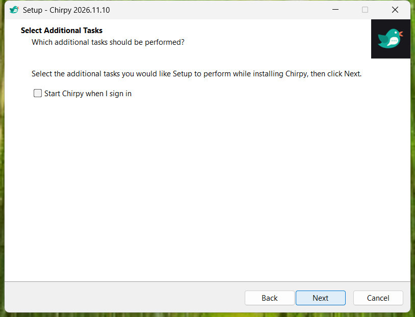

*"Start when I sign in" starts unchecked.*

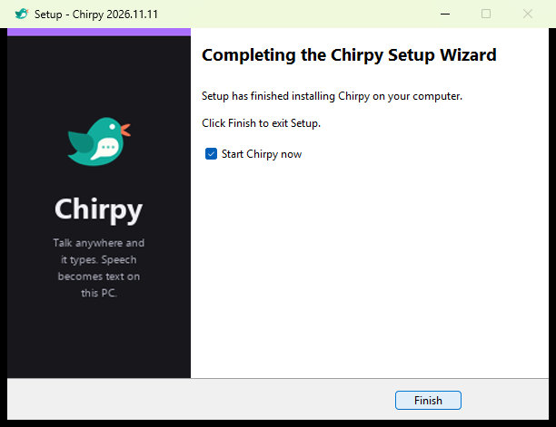

*The last page starts the app for you.*

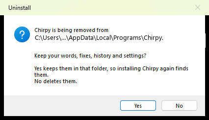

*Uninstall asks before touching your words and history. (User name hidden.)*

### Step 5. A second opinion (about 1 h a round)

Open a new conversation (or a different AI app) in the same folder and paste this. Give its answer to your builder: "Please fix these." Repeat until it says PASS.

**Copy this and paste it to your AI:**

```text
You didn't build this app; you're the second pair of eyes. Without changing anything, check it against the GOOD-ENOUGH LIST in PLAN.md: can it type twice or into the wrong app, lose or break my files, send anything online, or say something the code doesn't do? Install it in Windows Sandbox (on Windows Home: in a new test folder, and tell me what you couldn't check) and use it like a person trying to break it. Answer PASS or CHANGE, with each problem in plain words.
```

## 7. Make it your own

Once it works, change anything by asking for it. One change at a time, then try it.

| You want | Say to the AI |
|---|---|
| A different key | "Change the default dictate key to Right Alt." |
| A new look | "Make the whole app a warm orange. Keep the text easy to read." |
| Softer sounds | "Make the beeps softer and lower." |
| A feedback button | "Add Send feedback to the clock icon. It opens [my project's issue page] in my browser." |
| Another language | "Switch to a free multilingual speech model. Tell me its size, and how much worse English gets, first." |
| A smaller copy of an app you already have | "Make a free edition of my app from the same code, with the extra features left out. Prove the full app is unchanged." |

## 8. When something goes wrong

Tell the AI what you did and what happened, and ask it to read the app's log (Settings, *Open log*). It fixes most things in one message.

| What happens | Say to the AI |
|---|---|
| Nothing is typed | "I held the key in Notepad and talked. Nothing appeared. Read the log and fix it." |
| Everything is typed twice | "My text came out twice. Check whether more than one copy of the app is running." |
| Teach switched my keyboard language | "Shift + Alt switched my Windows language. Swallow it only when it's used as Teach." |
| Two dictations glued together ("today.Next") | "Put a space before my next dictation in the same window." |
| The window is blank | "The window came back blank. Restore it the way the taskbar button does." |
| "Couldn't save this change" | Close anything holding the app's files open (a sync tool, an editor) and try again. |

### Pitfalls we hit, so you don't

- **Starting from scratch twice.** Our first free version was a separate app and never felt right. If you already have an app, make the free one a lighter edition of it.
- **Leftover test copies.** Forty forgotten test copies made text come out twice. Tests must close what they open.
- **Two voice apps, one key.** Both type everything. Only one may run; the message handles it.
- **Testing on your real PC.** A clean Windows finds what yours hides (ours needed extra Microsoft files). Test in the Sandbox, early.
- **Promises the code can't keep.** "Nothing leaves this computer" wasn't true of the clipboard. Say only what's true.
- **Checks that never end.** Our outside checks ran twelve rounds until we wrote down what "good enough" means. Write it first.

## 9. Stay safe

- **Your microphone.** It listens only while you hold the key or have hands-free on, and the light shows it. Get people's OK before dictating their voices.
- **The clipboard.** To type, the app puts your words on the clipboard for about a second, then tries to put back what you had copied (pictures may not come back). If Windows clipboard history or sync is on, Windows may keep that text.
- **Your history** stays on your PC until you press Clear history.
- **Test away from your real PC.** Installs and key tests go in the Sandbox.
- **Unsigned installer.** Windows warns once (*More info*, *Run anyway*). Never turn your antivirus off for it.
- **Ask before deleting.** Tell the AI to ask you first and use the Recycle Bin.

## 10. Give it to a friend

When the second opinion says PASS, the AI can make a clean copy your friend installs with one double-click.

**Copy this and paste it to your AI:**

```text
Make a friend version of [Chirpy]: one Setup.exe that carries none of my words, history, settings, name or paths. Scan every file to prove it. Include a short README and the license and notices files. Test it in Windows Sandbox with no internet (on Windows Home: in a new test folder, and tell me what you couldn't check), then tell me its size and its SHA-256 hash. Don't send or publish anything; I will.
```

> [!NOTE]
> **How to send it.** Setup.exe is about 500 MB (it unpacks to about 840 MB), too big for email. Share it from OneDrive, Google Drive or Dropbox, with the hash so your friend can check it's the real file.

## 11. Words you'll hear

| Word | Plain meaning |
|---|---|
| Speech model | The AI "brain" file that turns your voice into text. This one is free and runs on your PC. |
| Hotkey | The key you hold to talk. It works in any program. |
| Tray | The icons by the clock, at the bottom right of Windows. |
| Clipboard | Where Windows keeps what you copy until you paste it. |
| Log | A diary file the app writes as it works. It lists words you taught, not what you dictated. |
| Windows Sandbox | A free, throwaway copy of Windows in a window. Everything in it vanishes when you close it. |
| Unsigned, SmartScreen | Not signed with a paid certificate, so Windows' SmartScreen warns once. It works the same. |
| MIT license | A short free license: anyone may use and share the code, as long as the copyright line stays. |
| Hash | A fingerprint of a file. Matching hashes mean the same file. |
