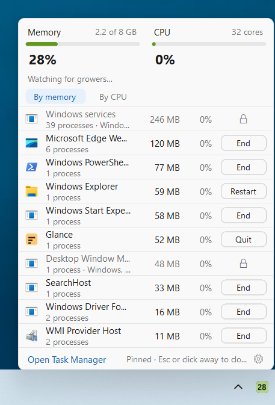

# Build your own memory meter with AI

A free little Windows app that shows your memory use right by the clock. Hover it to see which apps are using the most, and end a greedy one in two clicks, without opening Task Manager.

**You build it yourself, with AI, without writing any code.** This folder has everything you need: the step-by-step kit, every message to send, and the finished code to compare with or build directly. It's all open source.

> [!NOTE]
> **Made with Claude Code, works with any AI app.** We built ours with Claude Code. You can use any AI coding app you like, for example Antigravity, Codex or Cursor: the messages and steps are the same.



## Start here

1. **Read the kit:** [KIT.md](KIT.md), or the printable [PDF](docs/build-it-yourself-kit.pdf). It covers what you need, a 10-minute setup, your options, and every step.
2. **Paste the kickoff message** from [prompts/kickoff.txt](prompts/kickoff.txt) into your AI app. Change the [brackets] first.
3. **After each step, try it.** If it works, say "Works. Next step." That's most of the conversation.

It takes about an hour and a half, mostly waiting. You need a Windows PC and an AI app that can build on your computer: one that can create files and run programs for you, not just chat. **Any of them works**, for example Antigravity, Claude Code, Codex or Cursor. [KIT.md](KIT.md), section 3, shows where to paste the message in each. Nothing else to pay for.

## What's in here

| | |
|---|---|
| [KIT.md](KIT.md) | The build-it-yourself kit: setup, options, the steps, making it your own, fixing problems, staying safe |
| [docs/build-it-yourself-kit.pdf](docs/build-it-yourself-kit.pdf) | The same kit, ready to print |
| [prompts/](prompts/) | Every message to paste, as files you can copy, with [the order to send them](prompts/README.md) |
| [src/](src/) | The finished code of our copy, which we call Glance. Compare it with yours, or build it directly |
| [tools/](tools/) | The tests our copy passed (safe to run on your own PC), and the small test program they use |
| [AGENTS.md](AGENTS.md) | Notes your AI app reads to build and test the finished code (Codex reads it automatically; `CLAUDE.md` and `GEMINI.md` point other apps to it) |

Every lesson from our own build is already a line in the kickoff message. That includes what a second, independent review found before we shared it. So your first try should go more smoothly than ours did.

## Build the finished code instead

Want to skip to the end, or see how yours compares? Download it from the [repository's main page](https://github.com/petercarter19-hue/Apps) (the green **Code** button, then **Download ZIP**), unzip it, open the `glance` folder in your AI app (any of them), and say:

```text
Build this app into one file I can double-click, then start it. Install Microsoft's free .NET SDK first if it's missing.
```

Or, if you have the [.NET 10 SDK](https://dotnet.microsoft.com/download), run this in the `glance` folder:

```
dotnet publish Glance.csproj -c Release -r win-x64 --self-contained true -p:PublishSingleFile=true -p:IncludeNativeLibrariesForSelfExtract=true -p:EnableCompressionInSingleFile=true -o dist
```

The app is `dist\Glance.exe`. Because you built it on your own PC, Windows opens it without any warning.

**Just want to try ours?** A ready-made Glance.exe is on the [Glance 1.1.1 release](https://github.com/petercarter19-hue/Apps/releases/tag/glance-v1.1.1). Windows shows "Windows protected your PC" for downloaded apps that aren't code-signed. Click **More info**, then **Run anyway**.

## Using it

- **The number by the clock** is your memory use. Green under 60%, amber to 85%, red above. When memory crosses 90%, it pulses red once.
- **Hover** the number to open the card. You'll see memory and CPU meters, the app that grew the most in the last 10 minutes, and the top ten apps, one row per app.
- **End takes two clicks.** The first click turns the button into a red "End?"; the second ends the app. Windows' own parts show a lock instead, and Windows Explorer gets "Restart". If Windows refuses, the button offers **As admin**.
- **Click** the number to pin the card open. **Right-click** it for the menu: Show CPU tile, Start with Windows, Open Task Manager, Remove from this PC, Quit.
- **Can't see the number?** Windows tucks new icons under the **^** arrow by the clock. Click it and drag the number onto the taskbar.
- **To restart it,** open it again from the Start menu.

End works like Task Manager's "End task": anything unsaved in that app is lost.

**To remove it,** right-click the number and choose **Remove Glance from this PC**, then delete the app file. Removing turns off Start with Windows and deletes only Glance's own settings, log and preview pictures (in `%LocalAppData%\Glance`) and its Start menu shortcut. It never deletes your documents or photos.

**Privacy:** it only reads numbers Windows already has, makes no network connections, and collects nothing. Its settings live in `%LocalAppData%\Glance`.

## How the finished code works

C# / .NET 10 WinForms, no main window, Windows 10 or 11 (64-bit).

- **`TrayIcon`** talks to `Shell_NotifyIcon` at version 4, so Windows sends `NIN_POPUPOPEN` on hover. That is what lets the card replace the stock tooltip.
- **`ProcessScanner`** reads each process's private working set (Task Manager's "Memory" number) and CPU time, and groups processes by executable.
- **`ProcessKiller`** ends an app plus the processes it started:
  - It ends only the user's own programs: same sign-in session **and** same account. The account (SID) is read from the very same open process handle, right before the process is ended; if Windows won't say whose it is, it isn't ended.
  - A process only counts as a child if it started after its parent, because Windows reuses process numbers.
  - Each process is checked by its start time right before it's ended.
  - Windows' protected processes and Explorer are never swept in.
  - **As admin** runs a second copy of the app elevated with `--end`, which makes the same checks again, as the account that approved the prompt. (If you approve the prompt with a different administrator account, it refuses to end your programs, by design.)
  - Every route (the card, a program's children, the admin copy, the Explorer restart) ends processes through the one `ProcessKiller.Kill` method, so there is one place to check.
- **`HoverCard`** is a borderless, custom-painted window that follows the Windows light or dark setting and sits next to the tile on any taskbar edge.
- **`Shortcut`** keeps the Start menu entry.
- **Opening the app while it's running** signals the running copy to quit and takes its place.

**Tests** (in `tools\`). They are safe to run on your own PC. They never move your mouse, press keys, take pictures of your screen, or stop any program except the ones the test itself started (checked by process number and start time). They also never touch the copy of Glance you actually use, or its settings, startup entry or Start menu shortcut:

- `Tests\` is a small program that runs the real `src` files against a made-up Windows: foreign and unknown owners, other sign-in sessions, children, the admin copy and the Explorer restart. Nothing real is ended. Run it from this folder with `dotnet run --project tools\Tests -c Release`.
- `release-test.ps1` runs 26 checks: first run, restart, quit, a moved file, End with a child process, the start-time check, a leak check, and a check that your real Glance is untouched.
- `message-test.ps1` and `hover-test.ps1` send Windows' own hover and click events to the test copy's own window.
- `smoke-test.ps1` runs End against a test program that holds 3 GB.
- `safety-lint.ps1` checks that none of those scripts can capture the screen, move the pointer, press keys, stop a program by name, or touch your real Glance state. Run it whenever you change a script.
- **Before running them:** publish `tools\Hog` into `tools\Hog\dist` first (the scripts that use it take `-HogDir` or `-HogExe` if you put it elsewhere).
- **How the test copy stays separate:** the scripts set two environment variables for the copy they start. `GLANCE_TEST_NS` (1 to 24 letters or digits) gives it its own single-copy lock, quit signal, Start with Windows entry, shortcut and window titles. `GLANCE_TEST_DIR` (a full path) gives it its own settings folder. They exist for tests only; a bad value makes Glance refuse to start rather than fall back to the real names.
- `disposable-vm-only\` holds the one experiment that does need a real pointer and a real screen. It refuses to run anywhere except Windows Sandbox, and nothing runs it for you.

**Debug flags:**

- `--preview` writes the card's state and pictures to `%LocalAppData%\Glance` every second.
- `--pinned` opens the card at startup.
- `--quit` closes the running copy.

## License

[MIT](../LICENSE): use it, change it, share it.
