<p align="center">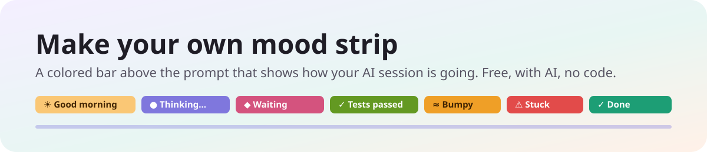</p>

One colored bar sits right above the box where you type to the AI. It tells you, at a glance, how things are going: what the AI is doing or thinking right now, the last few things it did, and how far through its plan it is. It turns purple while the AI works, pink when it's waiting for you, green for a win, orange when things get bumpy, red when it's stuck, and teal when it's done, always fading slowly from one color to the next. You don't write any code. You paste one message to the AI, try what it builds, and tell it what happened. There's nothing to pay for beyond your AI plan.

| ⏱️ About an hour | 💬 About 6 | 💵 $0 | 🧑‍💻 No code |
|:-:|:-:|:-:|:-:|
| step by step, mostly waiting | short messages to send | beyond your AI plan | you write none of it |

> [!IMPORTANT]
> **Made with Claude Code, works with any AI app:** We built ours with Claude Code. You can use any AI coding app you like, for example Antigravity, Codex or Cursor: the messages and steps are the same. Section 3 shows where to paste the message in each.

**Contents**

1. [🎯 What you'll end up with](#1--what-youll-end-up-with)
2. [🧰 What you need](#2--what-you-need)
3. [🛠️ Get set up (10 minutes)](#3-%EF%B8%8F-get-set-up-10-minutes)
4. [🎨 Choose your options](#4--choose-your-options)
5. [💬 The one message that builds it](#5--the-one-message-that-builds-it)
6. [🧪 Try each step](#6--try-each-step)
7. [✨ Make it your own](#7--make-it-your-own)
8. [🩹 When something goes wrong](#8--when-something-goes-wrong)
9. [🛡️ Stay safe](#9-%EF%B8%8F-stay-safe)
10. [🎁 Share it with a friend](#10--share-it-with-a-friend)
11. [📖 Words you'll hear](#11--words-youll-hear)

## 1. 🎯 What you'll end up with

- **One bar, edge to edge, above the prompt box.** It's the only thing there, and it's fully colored.
- **Three parts that use the whole length:**
  - **Left, right now:** "Reading app.js", "Running npm", "Thinking…".
  - **Middle, the story so far:** the last few steps ("Read app.js › Edited app.js › Tests ✓"), how it's going ("2 retries so far"), and helpers at work.
  - **Right, the plan:** one dot per step, filled when done, and the step it's on.
- **Its thinking, live.** While the AI thinks, the middle starts with a short, recent sentence of its thinking, in quotes. It's on by default and filtered the same way as everything else, and a setting turns it off, for example when you stream or share your screen (section 9).
- **Careful with what's on screen:** whole commands never show (just a well-known program's name, or "a command"), and file, helper or tool names with a path, a web address, a secret, a health or money subject, a letter outside the Latin alphabet, or any unusual word you've typed in the session just say "a file", "a helper" or "a tool". Long text is cut at a word, with "…".
- **Colors with meaning,** fading slowly from one to the next: purple working, pink waiting for you, green for a win, orange bumpy, red stuck, teal done.
- **A friendly idle look:** "Good morning · 9:30 AM", today's tasks and minutes of work, and how your last task went.
- **A demo:** type `/mood demo` to see every look with made-up examples.
- **Private:** it never shows your own messages, only what the AI is doing.

<p align="center">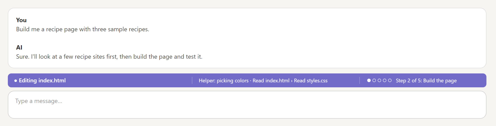<br><sub>Where it sits: right above the box you type in. (A simple drawing of a chat around the real strip.)</sub></p>

Building it takes about an hour, mostly waiting. You'll send about half a dozen short messages, or two if you let the AI build it all in one go.

## 2. 🧰 What you need

- **A Windows 11 PC.** The finished mod is tiny, well under 1 MB.
- **An AI app that can build on your computer:** one that can create files and run programs for you, not just chat, for example Antigravity, Claude Code, Codex or Cursor. Any of them works to build and change it; nothing in the messages is tied to one. You'll need a plan for it, if it needs one.
- **Claude Code, to see it.** The strip is a mod for Claude Code: it draws inside Claude Code's own window, in its desktop app or in the terminal. So whichever app you build with, you need Claude Code installed to run the strip. Building it from inside Claude Code is the easiest, because you watch it change right where you work.

| Part of the mod | What runs it | Cost |
|---|---|---|
| The strip and its colors | Code the AI writes, using Claude Code's built-in mod features | $0 |
| Knowing what the AI is doing | The mod watches the session's own steps; nothing is sent anywhere | $0 |
| Checking and testing it | Claude Code's built-in mod checker and test kit | $0 |
| AI models | None inside the mod. The AI is only the builder | $0 |

> [!TIP]
> You never need a credit card, an API key or a cloud account for the mod. It reads what's happening in your own session and keeps only today's counts, on your computer (see section 9).

## 3. 🛠️ Get set up (10 minutes)

1. **Install your AI app** and sign in. It must be one that can create files and run programs on your computer, not just chat.
2. **Open the part of your AI app that can work on your computer** (its agent). It's like the chat you know, but the AI can create files and run things on your computer.
3. **Make an empty folder** for your mod, for example `C:\MoodStrip`, and pick it when your AI app asks which folder to work in.
4. **When the AI asks permission** to run something, read the one-line description and allow it. Each app asks in its own way: an Allow button, or a setting for how much it may do without asking. Allowing it for this folder is how it builds and tests for you.

Where to paste the message in some popular AI apps. Their menus change often, so look for the same idea if yours looks different.

| If you use | Open your folder | Paste the message into | To see the strip |
|---|---|---|---|
| Antigravity | Open the empty folder as your workspace | A new conversation or task with the agent | Open Claude Code and start a new session |
| Claude Code | In the Claude desktop app, open the Code tab and pick the folder; or type `claude` in a terminal inside the folder | The chat box | Right there: it appears above the box you type in |
| Codex | In the Codex app, add the folder as a project; or type `codex` in a terminal inside the folder | The chat box | Open Claude Code and start a new session |
| Cursor | File › Open Folder | The Agent chat in that same window | Open Claude Code and start a new session |
| Something else | Any AI app that can create files and run programs in a folder on your PC | Wherever you talk to its agent | Open Claude Code and start a new session |

## 4. 🎨 Choose your options

Decide these before you start. Changing them later works, but it means rebuilding parts. Write your answers into the [brackets] of the message in the next section.

| Choice | Suggested | Notes |
|---|---|---|
| Your mod's name | mood-strip | Short, lowercase, with dashes. It's what `/plugin` lists. |
| How long a fade takes | 2.5 seconds | Slower feels calmer. Under a second starts to feel jumpy. |
| The colors | Purple working, pink waiting, green win, orange bumpy, red stuck, teal done, coral stopped | Any soft colors you like. The AI checks the words stay readable on each. |
| When "working" warms up | Past twice your usual | Your usual is the average of your recent tasks, starting at 3 minutes. |
| When it's "bumpy" and "stuck" | 2 failures in 10 minutes; the same step failing 3 times in a row | Raise them if you'd rather it stayed calm. |
| How long "Done" stays | About 3 minutes | Then it fades back to the time-of-day color. |
| The idle colors | Warm yellow morning, sky blue afternoon, rose evening, dark gray late night | Pick your own, or one color all day. |
| How often the thinking line updates | Every 2 seconds | Faster flickers; slower feels behind. |
| How long a thinking line can be | About 60 characters | Only whole sentences that fit are shown. |
| Show the thinking line | On | It's the "Show Claude's thinking" setting. Turn it off if you stream or share your screen and want nothing extra shown: the AI's thinking is filtered, but it can still include names, health or money details from your work. |

<table><tr><td align="center" valign="top">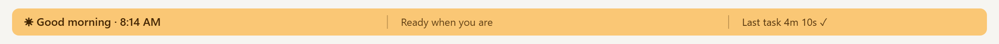<br><sub>Morning, idle</sub></td><td align="center" valign="top">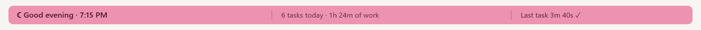<br><sub>Evening, idle</sub></td></tr></table>

## 5. 💬 The one message that builds it

Change the [brackets] and paste it into your AI app. It answers every question up front, so the AI can just build. (It names Claude Code because that's where the strip lives, whichever app you build it with.)

```text
I want to build a mod for Claude Code called [mood-strip]: a full-width colored strip right above the prompt box that shows how my session is going, at a glance. I'm not technical and I've never coded. Build it step by step, show me something working after each step, and test what you can yourself before asking me.

FREE, ON MY COMPUTER
- It's a Claude Code plugin (a mod with a hooks module that draws above the prompt). No paid services, no accounts, no API keys, never ask me for payment details. It sends nothing anywhere.
- First check which version of Claude Code I have and whether I use the desktop app or the terminal. Tell me in one line what you found.
- While we build, load it as a development mod that reloads when it changes, so I only need to start a new session or restart once. If I already have a copy of this mod installed, turn that copy off first, so only one copy draws the strip.

WHAT IT SHOWS
- The strip is the only thing above the prompt: one bar, fully colored, edge to edge, the exact width of the prompt box. It changes color with what's happening, and every change fades in slowly (about [2.5 seconds]); never a hard jump, never flashing.
- Three parts, using the whole length:
  - Left: what's happening right now ("Reading app.js", "Running npm", "Thinking…"). For commands, never show the whole command: show the program's name only for well-known programs (npm, git, python and the like), otherwise "a command". Text written into files is never a command, and a command with several parts (&&, ||, ;, a pipe) only says "Ran a command" unless every part is known to have run. Tests piped into another program end as "Tests finished", with no pass or fail. If a file, helper, skill, tool or step name holds a path or web address (look-alike slashes count), looks like a secret, names a health, money or identity subject, has a letter outside the Latin alphabet, or shares any word with anything I've typed in this session, including my answers to your questions, what I say when I turn a step down and what I type after a slash command (everyday words like "page" or "test" don't count, but names, nicknames, months, days and place codes like "UK" always do; accented letters, words in other alphabets, look-alike digits and a code name with its number left off count too), say "a file", "a helper", "a skill", "a tool" or "Step 2 of 5" instead. After a reload, keep names hidden until you can read back what I typed earlier or I send a new message.
  - Middle: a short trail of the last few things done ("Read app.js › Edited app.js › Tests ✓") and how it's going ("2 retries so far", "9 min, past your usual 3 min", helper names).
  - Right: the current plan step ("Step 2 of 5: Build the page") with one small dot per step, filled when done, from whichever kind of plan, task list or to-do list the AI keeps. If there's no plan, show how many steps and files so far.
- Moods and colors (pick colors dark enough that the words pass 4.5 to 1 contrast, and tell me what you picked):
  - Working: [purple]. Drifts toward [amber] when a task runs past [twice my usual length]; my usual is the average of my recent tasks, starting at [3 minutes].
  - Waiting on me (a question or a plan to approve): [pink], "Waiting for your answer".
  - Big moments (tests passed, installed, committed, pushed, pull request opened): [green] for a moment.
  - Bumpy (something failed, or [2] failures in 10 minutes): [orange]. Stuck (the same step failed [3] times in a row): [red], "Might need a new approach". A step I declined or interrupted, or a search or test that simply found nothing, is not a failure.
  - Done: [teal], "Done in 4m 10s", with a one-line recap in the middle (files changed with lines added and removed, tests passing, saved, retries). Teal stays for about [3 minutes], then fades back to the idle color in its last few seconds, so the recap stays easy to read. Stopped by me: [coral], "Stopped after 1m 12s". If the reply ended in an error or the AI declined, coral too, and say which ("Ran into an error after 2m 5s"). Say the step count only once.
  - Work started in the background shows as "Tests started" or "Helper started".
  - Builds show as "Building…", "✓ Build passed" or "✗ Build failed, fixing…", and the recap says "build passing". A build never counts as a test.
  - Idle: a greeting by time of day with the clock ("Good morning · 9:30 AM"), today's tasks and minutes of work in the middle, and how the last task went on the right. Morning [warm yellow], afternoon [sky blue], evening [rose], late night [dark gray].
- A thinking line, as a setting that is ON by default and that I can turn off: while the AI is thinking the middle starts with the latest complete sentence of its thinking, in quotes, up to about [60] characters, updated about every [2 seconds]. The setting's description warns that thinking often restates what I gave the AI, so it can put private details on screen, and says to turn it off when I stream or share my screen. If the setting is missing or has an odd value, treat it as on; only a clear false (the option unticked) turns it off. Leave out any sentence that repeats my own words, says "the user", quotes something, has a file path, web address, email or anything that looks like a password or key, has 5 or more digits in a row, looks like a phone number or street address, or talks about health, money, legal matters or identity. Also leave out any sentence that seems to name a person or a company: a title like Dr or Mrs before a capitalized word, or a capitalized word past the first word of the sentence that isn't a well-known tech word (GitHub, Python, React, JSON and the like); when in doubt, leave the sentence out and just show "Thinking…". When it starts writing the answer, the left says "Writing the answer…".
- Anything too long for its part is cut at a word, with "…", never in the middle of a letter: about 48 characters on the left, 75 in the middle and 48 on the right, with a soft fade at each part's right edge.
- Helpers (sub-agents) show by name while they work. Only the main conversation changes the strip; helpers never take it over.
- A /mood command that says what the strip shows, what each color means, the last problem it hit (or "none"), and the version. And /mood demo that plays every look with made-up examples, a few seconds each, then goes back to now. It only plays between tasks (during a task, say a task is running and to try between tasks), it can be run again any time, and a real reply ends it.
- In the terminal, show the same words on a colored line, in the mood's color at once (no fades or drifting there).

PRIVACY AND SAFETY
- Never show my own messages on the strip, not even a few words of them, and don't store them anywhere. Only what the AI is doing.
- No buttons and nothing to click on the strip.
- Keep only today's counts (tasks, work time, the last task), saved on this computer, and clear them when the day changes: at midnight while a session is open, or else the first time Claude Code starts on the new day. Never keep my messages. The usual task length comes from today's tasks alone, or 3 minutes until there are 2. Nothing is sent anywhere.
- Never fail silently: if something breaks, keep the session going, and show what went wrong as "Last problem" in /mood.
- Tests use a fake clock and fake storage. They never touch my real settings, my real sessions or my screen.

WHAT WE LEARNED BUILDING ONE (do these from the start)
- The desktop app ignores plain color codes on text boxes, which gives a white bar. Draw the strip as an SVG picture, which the desktop app paints exactly. Use the theme's named colors for the terminal.
- Redraw the picture only when what it shows changes. Do the fades with animation inside the picture, never by redrawing every second (that flashes).
- Make the picture very wide (4000 wide) and set its style to 100% width, or it only fills a third of the space.
- Each of the three parts is its own small area, so long words stop at its edge instead of running into the next part.
- Never show whole commands: they can hold passwords, keys or private paths. The program's name is enough.
- The AI's thinking can repeat my request or mention private things. Filter it as above, and show whole sentences only.
- The terminal can't do fades, so paint each mood's color at once there.
- Steps I decline and searches that find nothing aren't failures; don't turn the strip orange for them.
- Thinking often restates what I gave you, names and numbers included, so the thinking line is filtered exactly like everything else, and I can turn it off in the setting (for example when I stream or share my screen).
- Text written into a file can look like a command. Show program names only for well-known programs, otherwise "a command".
- A fade that starts right away makes "Done" hard to read. Hold the color, and fade only at the end.

BUILD ORDER (all of it by the end)
1. The full-width colored strip with the time-of-day greeting.
2. Working and done: what's happening now, the trail, the recap, and the slow fades.
3. How it's going: waiting on me, big moments, bumpy, stuck, longer than usual.
4. The plan step with dots, and helper names.
5. The thinking line (on by default, with a setting to turn it off), /mood and /mood demo.

HOW TO WORK WITH ME
- Plain English, short answers. Pick sensible defaults and tell me what you picked; don't ask me technical questions.
- Short plan first, then build. No long research reports.
- If I mention a new idea, add it to the list instead of building it, unless I say "now".
- After each step, run the tests, tell me plainly what you tested and what you couldn't, and tell me exactly what to do to see it (for example "start a new session" or "type /mood demo").

Start with step 1.
```

> [!IMPORTANT]
> **Want it all in one go?** Change the last line to: "Build all the steps without stopping. Test each one yourself, and only stop when everything works or you need a decision only I can make. Then tell me what to do to see it, and to type /mood demo." Then come back in about 40 minutes. It's also in [prompts/kickoff-all-in-one-go.txt](prompts/kickoff-all-in-one-go.txt).

## 6. 🧪 Try each step

After each step, try it yourself. If it works, just say **"Works. Next step."** Every decision is already in your first message, so that's all the AI needs. If something's off, say what you did and what you saw.

The AI tells you how to see each new version: usually "start a new session". The strip shows in any session, so a second session next to your building session is a handy place to watch it.

### Step 1 · The colored strip

Start a new session. Above the box you type in, you should see one bar, edge to edge, greeting you by the time of day. Check it reaches all the way across, and that it doesn't flash.

<p align="center"><br><sub>The idle look: a greeting, the time, and how your last task went.</sub></p>

### Step 2 · Working and done

Ask the AI something small that makes it work, for example "Read the README and make its first line a little friendlier." Watch the strip turn purple and say what it's doing, with a trail in the middle. When it finishes, it fades to teal with a short recap.

<p align="center">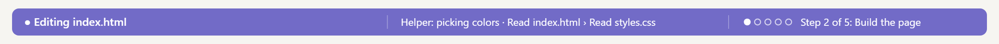<br><sub>Working: what's happening now, the trail so far, the plan.</sub></p>

<p align="center">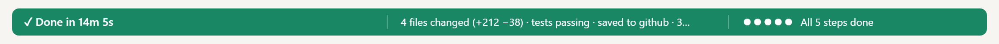<br><sub>Done: how long it took and what happened. It fades back to the time of day after a few minutes.</sub></p>

### Step 3 · How it's going

Ask the AI to ask you a question before it starts something; the strip turns pink while it waits. Once the reply is done, type `/mood demo` to see the rest: wins, bumpy, stuck and a long run, each for a few seconds. (The demo waits while a task is running, so it never hides real work.)

<table><tr><td align="center" valign="top">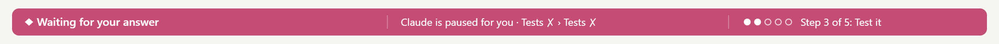<br><sub>Waiting for you: pink</sub></td><td align="center" valign="top"><br><sub>A win: green for a moment</sub></td></tr><tr><td align="center" valign="top">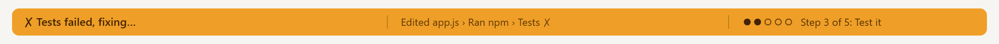<br><sub>Bumpy: orange</sub></td><td align="center" valign="top">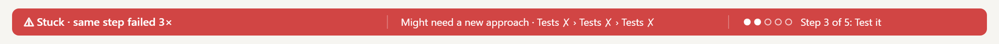<br><sub>Stuck: red, with a hint</sub></td></tr><tr><td align="center" valign="top"><br><sub>Longer than usual: warming to amber</sub></td><td align="center" valign="top">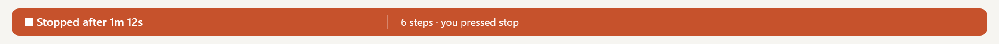<br><sub>Stopped by you: coral</sub></td></tr></table>

### Step 4 · The plan and helpers

Ask for something with a few steps, for example "Make a 3-step plan to tidy this folder, then do it, and use a helper to double-check the spelling." The dots on the right fill in as steps finish, and the helper shows by name in the middle.

<p align="center">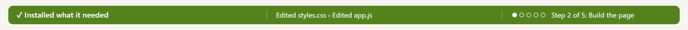<br><sub>The dots fill in as each step of the plan finishes.</sub></p>

### Step 5 · The thinking line and the demo

The thinking line is on from the start. To try it, ask a question that makes the AI think first, like "What's the best way to organize this folder? Think it through." The left says "Thinking…" and the middle starts with a short line of its thinking, updating every couple of seconds. To turn it off (for example when you stream or share your screen), type `/config`, find your mod's thinking setting, switch it off, then type `/reload-plugins`; switch it back on the same way. When the reply is done, type `/mood` to see what each color means and the last problem it hit (it should say "none"), and `/mood demo` for the full show.

<p align="center">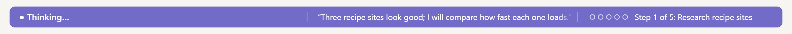<br><sub>The thinking line, in the middle (on by default, with a setting to turn it off). All the words in these pictures are made up.</sub></p>

## 7. ✨ Make it your own

Once it works, change anything by asking for it. Some starting points:

| You want | Say to the AI |
|---|---|
| Your own colors | "Make working blue and done gold. Keep the words readable on each." |
| A calmer strip | "Make the fades take 5 seconds, and only show bumpy after 3 failures." |
| To turn the AI's thinking off (or back on) | It's on by default: type `/config`, find your mod's thinking setting and switch it off (or on), then type `/reload-plugins`. |
| No thinking line, ever | "Remove the thinking line completely; just say Thinking… on the left." |
| A taller, bigger strip | "Make the strip a little taller, with bigger text on the left." |
| Different greetings | "Instead of the time of day, show a short motivating line each morning." |
| Your own sense of 'too long' | "Treat 10 minutes as my usual task length, and warm up only after 20." |
| Fewer parts | "Drop the plan dots; give the middle the extra room." |
| More to see | "Show how many files changed so far on the right when there's no plan." |
| A sound with the colors | "Play a soft chime when it turns green for a win." Keep it quiet, and say how often. |
| To know what's saved | "Tell me exactly what the mod saves on my computer, and where." |

> [!TIP]
> Ask for one change at a time, try it, then ask for the next. Say "build it in a copy and swap it in when the tests pass" for anything big, so the copy you're using never breaks.

## 8. 🩹 When something goes wrong

Always tell the AI what you did and what you saw. It fixes most things in one message.

| What happens | Say to the AI |
|---|---|
| You don't see the strip at all | "I don't see the strip. Check that only one copy of the mod is turned on, that it's loaded in this session, and tell me if I need to start a new session." |
| A plain white bar, no colors, no words | "The desktop app shows a white bar. Draw the strip as an SVG picture instead of colored text boxes." |
| It keeps flashing | "The strip flashes. Redraw only when what it shows changes, and do the fades inside the picture." |
| It only covers part of the width | "The strip only fills a third of the width. Make the picture 4000 wide and set its style to 100% width." |
| Your own message shows up on it | "Never show my messages on the strip. Remove that, and add a test that checks it." |
| Words run into each other | "Give each of the three parts its own area so long words stop at its edge." |
| The thinking line never appears | "The thinking line doesn't show. Check you're watching the main conversation's thinking as it streams, and test it." |
| The colors never change | "The strip stays one color. Type /mood and tell me what it says, then find out why." |
| Something seems off and you don't know why | Type `/mood` and read "Last problem". Then say: "/mood says the last problem was [what it says]. Fix it." |
| `/mood demo` says a task is running | That's on purpose: the demo would hide what the AI is doing. Try it once the reply is done. |
| A search that finds nothing, or a step you said no to, turns it orange | "Don't count a search or test that finds nothing, or a step I declined, as a failure." |
| Words are cut off in the middle of a letter | "Cut long text at a word, with …, so nothing is cut mid-letter." |
| It looks fine in the desktop app but not in the terminal | "In the terminal, show the same words on a colored line, in each mood's final color with no fades." |
| A whole command shows up, with its options or a path | "Never show whole commands on the strip, only the program's name." |
| The thinking line repeats what you asked, or shows a file path or a web address | "Filter the thinking line: whole sentences only, and leave out anything that repeats my request, mentions me, quotes something, or has a path, a web address or a key." |

## 9. 🛡️ Stay safe

- **Your words stay yours.** The strip never shows or keeps your messages, only what the AI is doing.
- **The thinking line is on by default, and filtered like everything else.** It shows a short line of what the AI is thinking. It hides your own words, file paths and secrets, but thinking often restates what you gave the AI, so a name, health or money detail it read in a file can still show. If you stream or share your screen and want nothing extra shown, turn it off in the plugin's settings (type `/config`, switch off the thinking row, then `/reload-plugins`).
- **Mind your screen when you share it.** Even with the thinking line off, the strip shows file names and what the AI is doing. Glance at it before you record.
- **Nothing leaves your computer.** The mod sends nothing anywhere.
- **What it keeps.** It keeps only today's counts (tasks, work time, the last task), on your computer, and clears them when the day changes: at midnight, or, if Claude Code wasn't running then, the first time it starts on the new day. It never keeps your messages. The task count and work time sit in one small file of its own on your computer (in the `plugins/store` folder inside your Claude Code settings folder, named like `mood-strip_apps-....json`). You can delete that file any time; counting then starts again from zero.
- **Tests don't touch your real setup.** They use a fake clock and fake storage, never your real settings or sessions.
- **Build big changes in a copy.** Swap them in only when the checks and tests pass, so the strip you use never breaks.
- **Only install mods you trust.** A mod runs inside your AI app. Read what it does, or have the AI explain it, before you turn it on.


## 10. 🎁 Share it with a friend

Want a friend to have your strip? Paste this. It makes a clean copy with none of your data, and a short how-to.

```text
Make a copy of my mood strip that I can share with a friend. Build it in a separate folder and don't touch the copy I use.
- None of my data: no saved counts, no logs, my name or my folder paths anywhere. Search the whole copy to prove it's clean.
- Package it as a plugin marketplace folder, with a short "How to add it" in plain words: how to add the marketplace and install the mod, that it needs Claude Code, how to see it (start a new session, then type /mood demo), and how to turn it off or remove it.
- Run the tests on the clean copy, check that it installs from that folder in a fresh session, and tell me what you checked.
```

## 11. 📖 Words you'll hear

| Word | What it means |
|---|---|
| AI coding app | An AI app that can create files and run programs on your computer, not just chat. For example Antigravity, Claude Code, Codex or Cursor. |
| Claude Code | The AI coding app the strip runs inside. The strip is one of its mods. |
| Mod (plugin) | A small add-on that changes how your AI app looks or behaves. You turn it on or off any time. |
| Prompt box | The box at the bottom where you type to the AI. The strip sits right above it. |
| Session | One conversation with the AI, from when you start it until you close it. |
| Hook | A spot where the mod is told "this just happened", like "a file was read" or "the reply is done". |
| SVG | A way to describe a picture in text. The strip is drawn as one, so its colors show exactly. |
| Fade | A slow change from one color to the next, done inside the picture so nothing flashes. |
| Plan | The short list of steps the AI makes before a bigger task. The dots show it. |
| Helper | A second AI the main one sends off to do part of the job, like checking spelling. |
| Thinking | What the AI works through before it answers. The strip shows its latest line. |
| Development mod | A copy of the mod loaded straight from your folder while you build, so changes show up quickly. |
| Marketplace | A list of mods you can add to your AI app and install from. |
| Tests | Small checks the AI writes and runs to prove each part works. |
