<p align="center">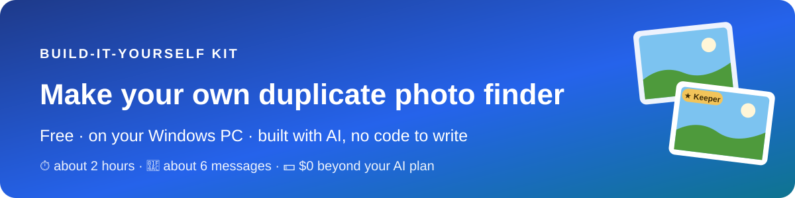</p>

Your computer probably holds the same photo several times: once from the phone, once in a backup, once sent back to you in a chat, once saved as a different type. This app finds them all, shows each group side by side with the best copy starred, and clears out the extras safely: to the Recycle Bin, with an Undo list that puts them back. You don't write any code. You paste one message to the AI, try what it builds, and tell it what happened. There's no AI inside the app and nothing to pay for beyond your AI plan.

| ⏱️ About 2 hours | 💬 About 6 | 💵 $0 | 🧑‍💻 No code |
|:-:|:-:|:-:|:-:|
| step by step, mostly waiting | short messages to send | beyond your AI plan | you write none of it |

> [!IMPORTANT]
> **Made with Claude Code, works with any AI app:** We built ours with Claude Code. You can use any AI coding app you like, for example Antigravity, Codex or Cursor: the messages and steps are the same. Section 3 shows where to paste the message in each.

**Contents**

1. [🎯 What you'll end up with](#1--what-youll-end-up-with)
2. [🧰 What you need](#2--what-you-need)
3. [🛠️ Get set up (10 minutes)](#3--get-set-up-10-minutes)
4. [🎨 Choose your options](#4--choose-your-options)
5. [💬 The one message that builds it](#5--the-one-message-that-builds-it)
6. [🧪 Try each step](#6--try-each-step)
7. [✨ Make it your own](#7--make-it-your-own)
8. [🩹 When something goes wrong](#8--when-something-goes-wrong)
9. [🛡️ Stay safe](#9--stay-safe)
10. [🎁 Give it to a friend](#10--give-it-to-a-friend)
11. [📖 Words you'll hear](#11--words-youll-hear)

## 1. 🎯 What you'll end up with

- **It finds three kinds of duplicate,** each on its own tab: **exact copies** (the same file twice, even with different names), **the same photo** saved again (smaller, re-saved, another type, or sent back to you in a chat app) and, if you switch it on, **look-alikes** (burst shots taken seconds apart).
- **It's careful about whose photo is whose.** Two photos only count as "the same photo" when their pictures match *and* their hidden photo info (when it was taken, and on which phone or camera) agrees. A friend's shot of the same birthday cake is never treated as a copy of yours.
- **Big pictures, side by side,** with the size, width × height, date taken, folder and file name under each one. Click a picture to see it full size.
- **The best copy is starred** as the keeper: the biggest picture first, then the original over a copy, then the one with its date and place info, then the oldest. One click moves the star.
- **Safe clearing out:** nothing goes without your click; every group keeps at least one photo; removed photos go to the Recycle Bin, and the Undo list puts them back exactly where they were in the app. Copies in shared folders are always kept, and it warns you before touching OneDrive or Google Drive.
- **A headline that tells you what it's worth:** "10 duplicates found. You can free 5.7 MB." That's our small made-up library; on a real one it's often many gigabytes.
- **Fast the second time:** it remembers every photo's fingerprint and small picture, so the next scan only looks at what changed, and the groups appear instantly.
- **A polished look** that follows Windows' light or dark setting, and one file you double-click, in your Start menu.

<p align="center"><br><sub>Ours after a scan. Yours will look much like it, with your own photos.</sub></p>

Building it takes about two hours, mostly waiting. You'll send about half a dozen short messages, or two if you let the AI build it all in one go.

## 2. 🧰 What you need

- **A Windows 11 PC** with about 1.5 GB of free space. That's Microsoft's free building tools (about 800 MB), the free photo reader the app uses, and the project. The finished app itself is one file of about 70 MB.
- **An AI app that can build on your computer:** one that can create files and run programs for you, not just chat, for example Antigravity, Claude Code, Codex or Cursor. Any of them works; nothing here is tied to one. You'll need a plan for it, if it needs one. The AI does the building. It's the only thing you pay for.
- No graphics card and no AI models to download.

| Part of the app | What runs it | Cost |
|---|---|---|
| Reading every photo type, iPhone HEIC included | Magick.NET, a free, well-known image library (the AI adds it) | $0 |
| Fingerprints, matching, the keeper and the safety checks | Code the AI writes | $0 |
| The Recycle Bin and Undo | Features built into Windows | $0 |
| Building it | Microsoft's free .NET SDK, which the AI installs if it's missing | $0 |
| AI models | None. The AI is only the builder | $0 |

> [!TIP]
> You never need a credit card, an API key or a cloud account. The app reads your photos on your own computer and sends nothing anywhere.

## 3. 🛠️ Get set up (10 minutes)

1. **Install your AI app** and sign in. It must be one that can create files and run programs on your computer, not just chat.
2. **Open the part of your AI app that can work on your computer** (its agent). It's like the chat you know, but the AI can create files and install things on your computer.
3. **Make an empty folder** for your app, for example `C:\PhotoTwins`, and pick it when your AI app asks which folder to work in.
4. **When the AI asks permission** to run something or install Microsoft's building tools, read the one-line description and allow it. Each app asks in its own way: an Allow button, or a setting for how much it may do without asking. Allowing it for this folder is how it installs things for you.

Where to paste the message in some popular AI apps. Their menus change often, so look for the same idea if yours looks different.

| If you use | Open your folder | Paste the message into |
|---|---|---|
| Antigravity | Open the empty folder as your workspace | A new conversation or task with the agent |
| Claude Code | In the Claude desktop app, open the Code tab and pick the folder; or type `claude` in a terminal inside the folder | The chat box |
| Codex | In the Codex app, add the folder as a project; or type `codex` in a terminal inside the folder | The chat box |
| Cursor | File › Open Folder | The Agent chat in that same window |
| Something else | Any AI app that can create files and run programs in a folder on your PC | Wherever you talk to its agent |

## 4. 🎨 Choose your options

Decide these before you start. Changing them later works, but it means rebuilding parts. Write your answers into the [brackets] of the message in the next section.

| Choice | Suggested | Notes |
|---|---|---|
| Your app's name | PhotoTwins | Anything you like. It's what you'll see in the Start menu and on the window. |
| Look-alike strictness | Normal | Strict only pairs near-identical burst shots; Loose also pairs shots where you moved a little. Look-alikes stay off until you switch them on in Settings, and you can change this there any time. |
| The look | A slim dark header bar over a soft dark-to-light fade, glass cards, rounded buttons with soft shadows | Describe any look you like: "plain and simple", "bright and colorful", "like the Photos app". Light and dark both follow Windows. |

<p align="center">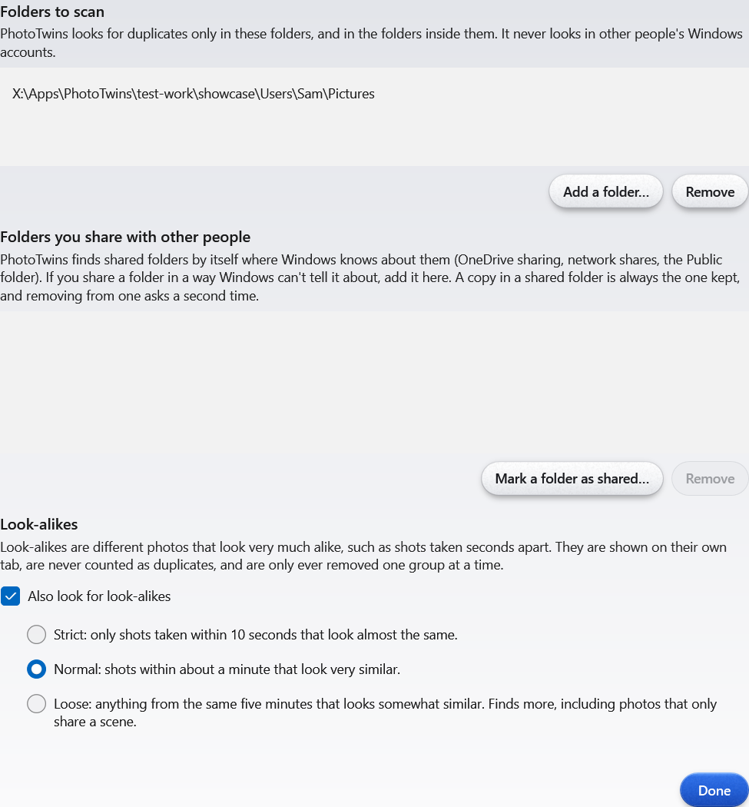<br><sub>Settings: which folders it scans, look-alikes and how strict, and your shared folders.</sub></p>

> [!NOTE]
> Your display scaling (how much Windows enlarges things) and where your photos are aren't choices: the message asks the AI to check both first.

## 5. 💬 The one message that builds it

Change the [brackets] and paste it into your AI app. It answers every question up front, and every lesson from our own build is already a line in it, so the AI can just build.

```text
I want to build a small Windows app called [PhotoTwins]. It finds duplicate photos on my computer, shows them side by side, and lets me clear out the extra copies safely. I'm not technical and I've never coded. Build it step by step, show me something working after each step, and test what you can yourself before asking me.

FREE, ONE FILE, ON MY COMPUTER
- Everything is free and runs on this computer. No paid services, no accounts, no API keys, never ask me for payment details. It doesn't need any AI model: it compares photos by their "fingerprints".
- My photos never leave this computer. The app never uploads or sends anything.
- First check my computer: the Windows version, my display scaling, where my photos are (Pictures, OneDrive, phone imports, other drives) and roughly how many there are, and which free building tools are already installed. Install anything missing from Microsoft or other well-known, trusted sources, and tell me in one line what you picked and how big it is.
- The finished app is one file I double-click, with a Start menu entry. Keep it in one place and always run that copy.

WHAT IT FINDS
- Photo types: JPG, PNG, HEIC (iPhone photos), WEBP, BMP and TIFF. If a type needs something extra to read, use a free, well-known one and tell me.
- Three kinds of match, shown on separate tabs:
  1. Exact copies: the same file twice, even with different names.
  2. Same photo: one picture saved more than once (resized, re-saved, a different type, or sent back to me in a chat app).
  3. Look-alikes: shots taken seconds apart, like a burst. Off by default; I turn it on in Settings, with a strictness setting [Normal].
- Only call two photos "the same photo" when their fingerprints match AND the hidden photo info (date and time taken, which camera or phone) doesn't disagree. If it disagrees, they're different photos, at most look-alikes. Compare the time taken down to the fraction of a second, so burst shots never count as copies. This is how a friend's shot of the same birthday cake never counts as a copy of mine.
- If a photo in a "same photo" group has no date info, show one plain line on that group: "Some of these have no date info. Check they're really the same photo before removing."
- It scans the folders I pick. It starts with my Pictures folder and remembers my list. It never looks in other people's Windows accounts. A folder that is really a shortcut to somewhere else is judged by where it leads.
- It skips files that are only in the cloud (OneDrive or Google Drive "online-only" files). It never downloads them.

WHAT I SEE
- A progress bar while it scans: how many photos so far, and time left. I can pause or stop at any moment, including while it groups the photos or gets ready to remove: nothing moves after I press Stop, and it picks up where it left off. Closing the window while it works waits for the work to finish safely. It remembers fingerprints, so the next scan is quick.
- A headline: "N duplicates found. You can free X GB."
- Each group side by side, with big pictures and under each one: size, width x height, date taken, folder and file name. Click a picture to see it full size. Make a small picture of each photo during the scan and remember it, so the groups appear instantly, even with thousands of photos.
- A suggested keeper in each group, marked with a star: the biggest picture first (the most pixels, width x height, not the biggest file), then the original over a copy ("(1)", "copy", "edited", or a converted file or one in a "Converted" or "Edited" folder), then the one with its date and place info, then the oldest. I can move the star with one click.

CLEARING OUT
- Nothing is removed without my click. "Remove the others" works on one group. "Remove all exact copies" and "Remove all same-photo copies" first show a summary (how many photos, how many GB) and ask me to confirm; "Remove all same-photo copies" skips groups with missing date info. Look-alikes are never removed in bulk, only one group at a time.
- Every group always keeps at least one photo. The app refuses to remove the last copy.
- Shared folders (ones shared with family or anyone else, on this PC or in OneDrive or Google Drive): the copy in the shared folder is always the keeper, and removing anything from a shared folder needs a second, clearly worded confirm.
- Removed photos go to the Recycle Bin, never deleted for good. Before a removal, add up everything it will send to each drive's Recycle Bin: if it wouldn't all fit (Windows quietly empties the oldest items when the bin overflows), send the rest to the "Duplicates to delete" folder instead, or ask me to empty the bin first.
- Where there's no Recycle Bin (USB sticks, memory cards, network drives), move them to a "Duplicates to delete" folder on that drive instead.
- Just before each photo moves, check again that its keeper is still there and unchanged, and that the photo itself hasn't changed. Skip and list any that fail.
- An Undo list puts photos back, one at a time or all at once. It only puts back the exact file that was removed, and each photo reappears in the app in the same group, tab and spot, with no rescan. Keep the Undo record safe even if the power cuts out mid-write, and note each put-back before it happens, so the record never says a photo is gone when it's back.
- Before removing anything from a OneDrive or Google Drive folder, warn me in one line that it will also disappear from the cloud and my other devices, and ask once.
- Never change, move or rename the photo I keep. Never touch anything outside the folders I picked. A folder can be a shortcut or link to somewhere else: right before every move and every Undo, check that where it really leads is still inside my folders, and never follow a link out of them.

THE LOOK
- Polished and calm: [a slim dark header bar with the headline, Settings and Scan, over a soft dark-to-light fade, with the groups on glass cards and rounded buttons with soft shadows]. Small groups sit side by side, so there's no wasted space. Undo and "Remove all" sit on the same line as the tabs.
- It follows the Windows light or dark setting, and fits my display scaling with no cut-off text. Show me a picture at my scaling. If Windows high contrast is on, use Windows' own plain look instead.

SAFETY
- Never fail silently. If it can't read a photo, list it ("Couldn't read 3 photos") and write it to a log.
- Handle very long folder paths and names in any language.
- Tests only use test photos you make for the purpose (copies, resized, re-saved and burst-style pictures) in a test folder, never my real photos. Tests never take pictures of my real screen, move my mouse or press real keys: use the app's own pictures of itself instead.

BUILD ORDER (all of it by the end)
1. Pick folders and scan, with the progress bar; find exact copies and list them.
2. Same-photo matches, shown side by side with the details under each picture, and the full-size view.
3. The suggested keeper, Remove (Recycle Bin, or the "Duplicates to delete" folder), Undo, and the "You can free X GB" headline.
4. Look-alikes with the strictness setting, remembered fingerprints and pictures, the look, light and dark, and the finished one-file app with its Start menu entry.

HOW TO WORK WITH ME
- Plain English, short answers. Pick sensible defaults and tell me what you picked; don't ask me technical questions.
- Short plan first, then build. No long research reports.
- If I mention a new idea, add it to the list instead of building it, unless I say "now".
- Build each new version in a separate folder and swap it in only after your tests pass. Quit the old copy first, so there's only ever one copy running.
- After each step, show me a picture, and tell me plainly what you tested and what you couldn't.
- When the removal steps work, review everything that can remove or put back a photo as if a stranger's whole photo library depended on it, fix what you find, and tell me what you checked.

Start with step 1.
```

> [!IMPORTANT]
> **Want it all in one go?** Change the last line to: "Build all the steps without stopping. Test each one yourself, and only stop when everything works or you need a decision only I can make." Then come back in about two hours.

## 6. 🧪 Try each step

After each step, try it yourself. If it works, just say **"Works. Next step."** Every decision is already in your first message, so that's all the AI needs. If something's off, say what you did and what you saw.

> [!TIP]
> **Try it on one folder first,** for example your phone imports, before you point it at everything. Check a few groups, remove a few photos, and try Undo. Then let it loose on the rest.

### Step 1 · Pick folders and scan

Open the app. It starts with your Pictures folder; add others under Settings. Click **Scan** and watch the progress bar count your photos. Try **Pause** and **Stop**: the next scan picks up where it left off. The exact copies appear on the first tab.

<table><tr><td align="center" valign="top" width="50%">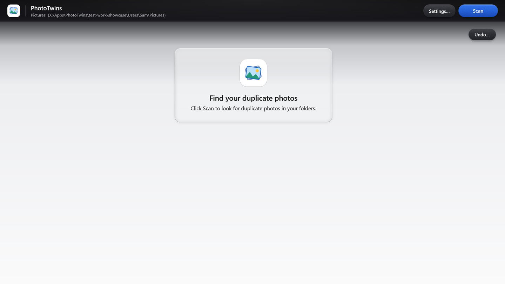<br><sub>Before the first scan</sub></td><td align="center" valign="top" width="50%">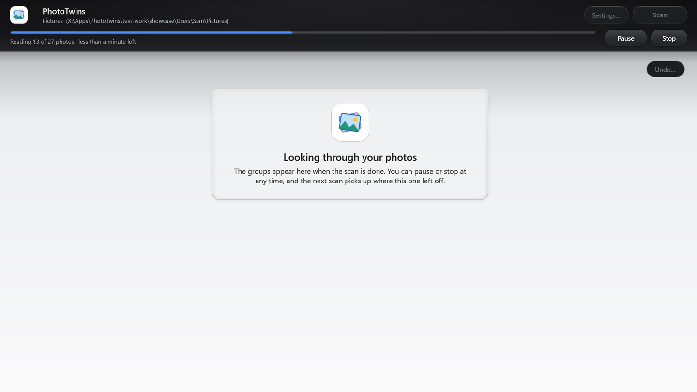<br><sub>Scanning: photos so far, time left, Pause and Stop</sub></td></tr></table>

### Step 2 · The same photo, side by side

Click the **Same photo** tab. Each group shows one picture saved in different ways: a smaller copy, a PNG, the version a chat app sent back. Check the details under each picture, then click a picture to see it full size and step through the group with **Next**.

<p align="center">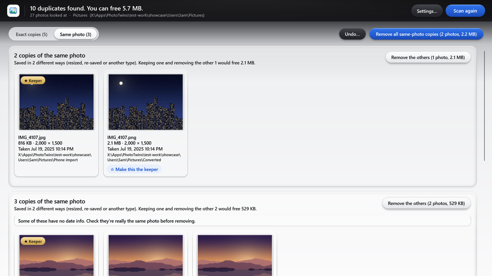<br><sub>One photo, saved three ways. The details under each picture show how they differ.</sub></p>

<p align="center">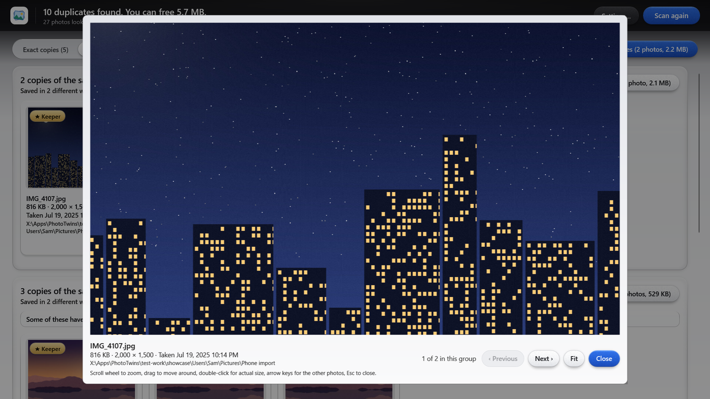<br><sub>Click any picture to see it full size.</sub></p>

### Step 3 · The keeper, Remove and Undo

Look for the ★ on each group: that's the copy it suggests keeping. Click **Make this the keeper** on another photo to move the star. Click **Remove the others** on one group, and watch the headline go down. Then click **Undo…** and **Put back**: the photo comes back to the same group, in the same spot. Try **Remove all exact copies** too: it shows a summary and asks first.

<table><tr><td align="center" valign="top" width="50%">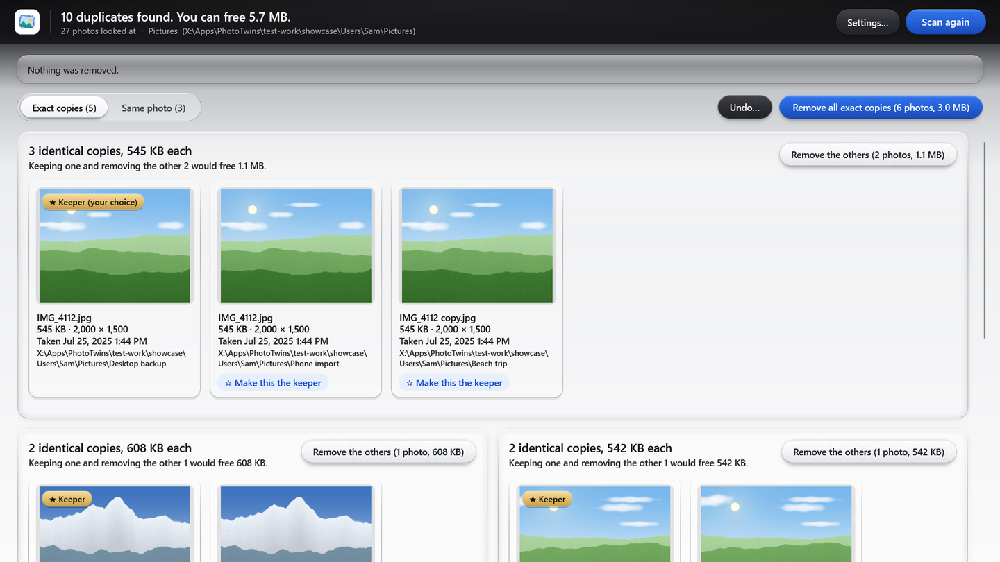<br><sub>One click moves the ★ keeper</sub></td><td align="center" valign="top" width="50%">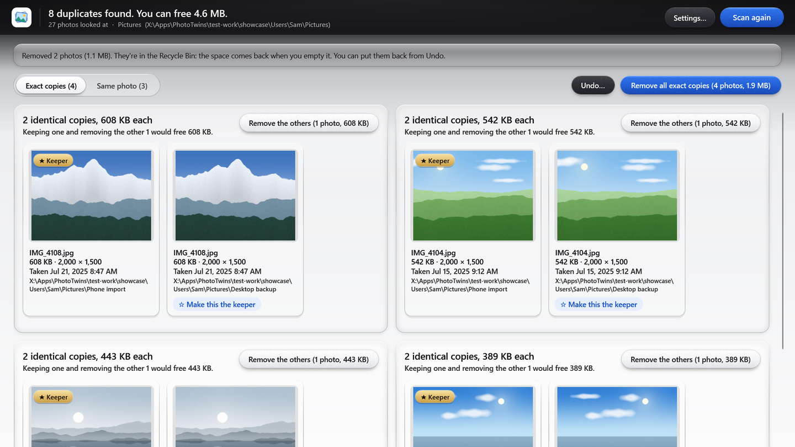<br><sub>After "Remove the others": one group fewer</sub></td></tr></table>

<table><tr><td align="center" valign="top" width="50%">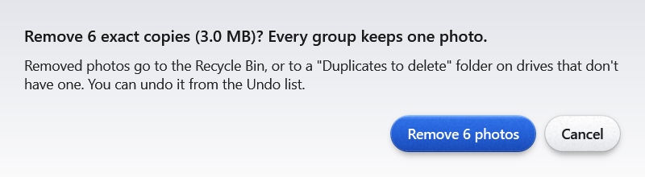<br><sub>Every bulk removal asks first</sub></td><td align="center" valign="top" width="50%">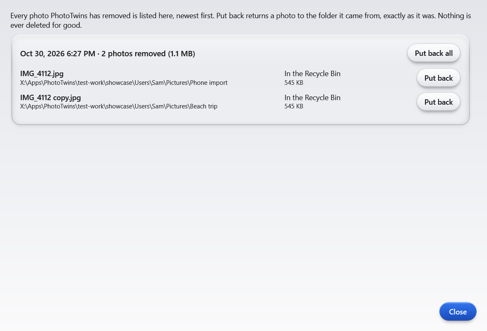<br><sub>Undo puts it back</sub></td></tr></table>

### Step 4 · Look-alikes, the look and the finished app

Open **Settings**, switch on look-alikes, close it and scan again: burst shots appear on their own tab, and they're only ever removed one group at a time. Switch Windows to dark mode and look again. Finally, close the app and open it from the Start menu: type its name.

<p align="center">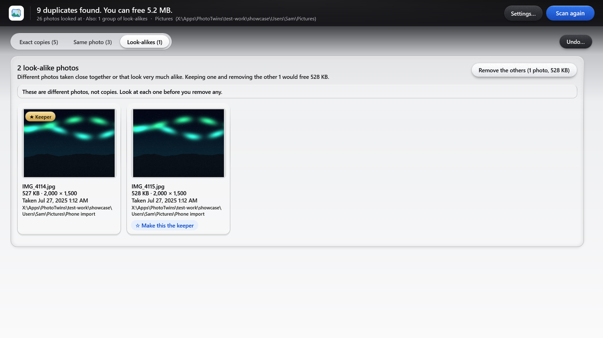<br><sub>Look-alikes: two shots a second apart. Never removed in bulk.</sub></p>

<p align="center">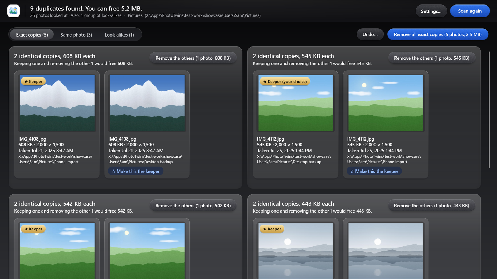<br><sub>It follows Windows' dark mode.</sub></p>

## 7. ✨ Make it your own

Once it works, change anything by asking for it. Some starting points:

| You want | Say to the AI |
|---|---|
| A different look | "Make it plain and simple, like Windows' own Settings app," or "use bigger pictures and larger text." |
| More photo types | "Also find duplicate RAW photos (.CR2, .NEF, .ARW) and GIFs." |
| Videos too | "Also find duplicate videos: exact copies only, by their fingerprint." |
| A different keeper | "Prefer the copy in my 'Phone import' folder as the keeper when the pictures are the same size." |
| Certain folders left alone | "Never suggest removing anything from these folders: [folders]." |
| Look-alikes that pair more or fewer shots | Change it in Settings, or say: "Make Normal look-alikes a bit stricter." |
| A tidy-up report | "After a removal, show a short summary I can save: how many photos and how much space, by folder." |
| To know where things are saved | "Tell me where the settings, the remembered fingerprints, the Undo list and the log are saved, and add 'Open log folder' to Settings." |

> [!TIP]
> Ask for one change at a time, try it, then ask for the next. Say "build it in a separate folder and swap it in when the tests pass" for anything big, so the copy you're using never breaks.

## 8. 🩹 When something goes wrong

Always tell the AI what you did and what you saw, and ask it to read the log. It fixes most things in one message. These are the problems we actually hit:

| What happens | Say to the AI |
|---|---|
| A converted PNG is starred over the original JPG | "The keeper should be the copy with the most pixels, not the biggest file. When they tie, prefer the original over a converted copy." |
| The pictures say "Drawing the picture…" for a long time | "Make the small pictures during the scan and remember them, so the groups appear instantly." |
| After a scan, the second batch can only be removed one group at a time | "Add 'Remove all same-photo copies'. Ask first, and skip any group with missing date info." |
| Undo puts a photo back, but it's not in the app until you scan again | "When Undo puts a photo back, show it again in the same group, tab and spot, without a rescan." |
| It says it couldn't read some photos | "Show me the list of photos it couldn't read and why, and check the log." |
| The groups leave big empty spaces, or the top bar wastes room | "Tighten the layout: put small groups side by side, and fit the headline and buttons in one slim bar." |
| A big removal might not fit in the Recycle Bin | "Before removing, check the whole removal fits in each drive's Recycle Bin. Send anything that doesn't fit to the 'Duplicates to delete' folder, or ask me to empty the bin first." |
| A rebuild fails, saying the file is in use | "Quit the running copy first, build in a separate folder, then swap it in." |

## 9. 🛡️ Stay safe

- **Try one folder first.** Check a few groups, remove a few photos and try Undo before you run it on everything.
- **Removed means Recycle Bin, not gone.** Keep the bin until you're sure. Emptying it is what really deletes them, and Undo can't bring them back after that.
- **Keep a backup of your photos.** A duplicate finder is careful, but a backup is the only real safety net. Back up before any big clean-up.
- **Shared and cloud folders affect other people and devices.** The app keeps shared-folder copies and warns before touching OneDrive or Google Drive. Read those warnings.
- **Check groups with no date info by eye.** If the app says some photos have no date info, make sure they really are the same photo before removing.
- **Tests use test photos, never yours.** The message tells the AI to make its own test photos in a test folder.
- **Nothing leaves your computer.** The app never uploads or sends anything.
- **Only download from trusted sources.** The message tells the AI to get its building tools from Microsoft or other well-known sources.

## 10. 🎁 Give it to a friend

When yours works, the AI can package a clean copy that a friend starts with one double-click. It contains none of your settings, history or photos.

```text
Make a friend version of my app that I can send as one zip. Build it in a separate copy and don't touch the app I use.
- None of my data: no settings, logs, remembered fingerprints or pictures, Undo list, my name, or my folder paths anywhere. Search the whole copy to prove it's clean.
- One file that runs without installing anything else, plus a one-page "How to start it" in plain words: how to open it, that it starts with the Pictures folder, how to add folders, that removed photos go to the Recycle Bin and come back with Undo, and what to do if Windows shows "Windows protected your PC" for a file from a friend.
- Before you give it to me, run it from scratch in Windows Sandbox with a folder of test photos you make there, and check that scanning, the groups, Remove and Undo all work. Never use my real photos for this.
```

> [!NOTE]
> **What's Windows Sandbox?** Windows Sandbox is a clean, throwaway copy of Windows inside your PC: a perfect stand-in for your friend's computer. It comes with Windows 11 Pro. Turn it on under Start › "Turn Windows features on or off" › Windows Sandbox, then restart. Share the zip from Google Drive or OneDrive with just your friend's email.

## 11. 📖 Words you'll hear

- **Duplicate:** an extra copy of a photo you already have.
- **Fingerprint:** a short code worked out from a photo's picture. Two copies of the same picture have matching fingerprints, even if one is smaller or another type.
- **Photo info (EXIF):** hidden details a phone or camera saves inside each photo: when it was taken, on which device, and sometimes where.
- **HEIC:** the photo type iPhones save by default.
- **Keeper:** the copy the app suggests keeping, marked with a ★.
- **Look-alikes:** different shots taken seconds apart, like a burst. Similar, but not copies.
- **Recycle Bin:** where Windows puts things you remove, until you empty it.
- **Online-only file:** a OneDrive or Google Drive file that lives in the cloud and only downloads when opened. The app skips these.
- **Display scaling:** how much Windows enlarges everything on screen (Settings › System › Display › Scale).
- **.NET SDK:** Microsoft's free kit for building Windows apps. The AI uses it to build; the finished app doesn't need it.
- **Log:** a diary file the app writes as it works. When something goes wrong, the AI reads it to find out why.
- **AI coding app:** an AI app that can create files and run programs in a folder on your computer, for example Antigravity, Claude Code, Codex or Cursor.
- **Prompt:** a message you type to the AI.
