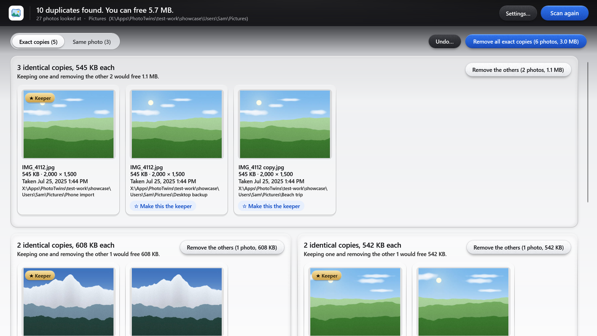

# Build your own duplicate photo finder with AI

A free Windows app that finds the same photo saved more than once on your computer, shows each group side by side with the best copy starred, and clears out the extras safely: to the Recycle Bin, with an Undo list that puts them back.

**You build it yourself, with AI, without writing any code.** This folder has everything you need: the step-by-step kit, every message to send, and the finished code to compare with or build directly. It's all open source.

> [!NOTE]
> **Made with Claude Code, works with any AI app.** We built ours with Claude Code. You can use any AI coding app you like, for example Antigravity, Codex or Cursor: the messages and steps are the same.



## Start here

1. **Read the kit:** [KIT.md](KIT.md), or the printable [PDF](docs/build-it-yourself-kit.pdf). It covers what you need, a 10-minute setup, your options, and every step.
2. **Paste the kickoff message** from [prompts/kickoff.txt](prompts/kickoff.txt) into your AI app. Change the [brackets] first.
3. **After each step, try it.** If it works, say "Works. Next step." That's most of the conversation.

It takes about two hours, mostly waiting. You need a Windows PC and an AI app that can build on your computer: one that can create files and run programs for you, not just chat. **Any of them works**, for example Antigravity, Claude Code, Codex or Cursor. [KIT.md](KIT.md), section 3, shows where to paste the message in each. Nothing else to pay for.

## What's in here

| | |
|---|---|
| [KIT.md](KIT.md) | The build-it-yourself kit: setup, options, the steps, making it your own, fixing problems, staying safe |
| [docs/build-it-yourself-kit.pdf](docs/build-it-yourself-kit.pdf) | The same kit, ready to print |
| [prompts/](prompts/) | Every message to paste, as files you can copy, with [the order to send them](prompts/README.md) |
| [src/](src/) | The finished code of our copy, PhotoTwins. Compare it with yours, or build it directly |
| [tests/](tests/) | The 468 tests our copy passed, all on made-up photos |
| [tools/](tools/) | The installer that builds, checks and swaps in the one-file app |
| [AGENTS.md](AGENTS.md) | Notes your AI app reads to build and test the finished code (Codex reads it automatically; `CLAUDE.md` and `GEMINI.md` point other apps to it) |

Every lesson from our own build is already a line in the kickoff message. That includes what two independent safety reviews found before we used it on real photos, and what a final outside review found before we shared it. So your first try should go more smoothly than ours did.

## Build the finished code instead

Want to skip to the end, or see how yours compares? Download it from the [repository's main page](https://github.com/petercarter19-hue/Apps) (the green **Code** button, then **Download ZIP**), unzip it, open the `phototwins` folder in your AI app (any of them), and say:

```text
Build this app into one file I can double-click, put it in my Start menu, then start it. Install Microsoft's free .NET SDK first if it's missing.
```

Or, if you have the [.NET 10 SDK](https://dotnet.microsoft.com/download), run this in the `phototwins` folder:

```
powershell -ExecutionPolicy Bypass -File tools\install.ps1
```

It builds the app, checks it, puts it at `app\PhotoTwins.exe` and adds **PhotoTwins** to your Start menu. Because you built it on your own PC, Windows opens it without any warning.

**Just want to try ours?** A ready-made PhotoTwins.exe is on the [PhotoTwins 1.0.0 release](https://github.com/petercarter19-hue/Apps/releases/tag/phototwins-v1.0.0). Windows shows "Windows protected your PC" for downloaded apps that aren't code-signed. Click **More info**, then **Run anyway**.

## Using it

- **Scan.** It starts with your Pictures folder; add or remove folders under **Settings**. The progress bar shows photos counted and time left; **Pause** and **Stop** keep what it found, and the next scan only looks at what changed.
- **Three tabs.** **Exact copies** are the same file twice. **Same photo** is one picture saved again: smaller, re-saved, another type, or sent back in a chat app. **Look-alikes** (switch them on in Settings: Strict, Normal or Loose) are burst shots taken seconds apart.
- **The ★ keeper** is the copy it suggests keeping: the most pixels first, then the original over a copy, then the one with its date and place info, then the oldest. **Make this the keeper** moves the star.
- **Remove the others** clears one group. **Remove all exact copies** and **Remove all same-photo copies** show a summary and ask first. Look-alikes are only ever removed one group at a time.
- **Undo…** lists everything removed. **Put back** returns a photo to its folder and to the same spot in the app.
- **Click a picture** to see it full size, with **Previous** and **Next**.

**What keeps your photos safe:** nothing is removed without your click; every group keeps at least one photo; removed photos go to the Recycle Bin (or a "Duplicates to delete" folder on drives without one); copies in shared folders are always kept; it warns before touching OneDrive or Google Drive; it skips online-only cloud files; and it never changes, moves or renames the photo you keep.

**Privacy:** it reads your photos only on your own computer, makes no network connections, and collects nothing. Its settings, remembered fingerprints and pictures, Undo list and log live in `%LocalAppData%\PhotoTwins`.

## How the finished code works

C# / .NET 10 WPF, Windows 10 or 11 (64-bit). Photos are read with [Magick.NET](https://github.com/dlemstra/Magick.NET), which handles JPG, PNG, HEIC, WEBP, BMP and TIFF.

- **`PhotoTwins.Core\Scanning`** walks the folders you picked: never other Windows accounts, never online-only files, and a folder link is judged by where it really leads.
- **Fingerprints:** a SHA-256 of the file finds exact copies; two picture fingerprints of the photo's pixels (pHash and dHash), plus its hidden photo info (date taken, phone or camera), find the same photo saved again. When the info disagrees, they're different photos.
- **`Matching`** groups them and picks the keeper. **Look-alikes** need close fingerprints and dates taken within 10 seconds (Strict), 60 seconds (Normal) or 5 minutes (Loose).
- **`Removal`**: a safety gate checks every photo before it moves (the keeper is still there and unchanged, the group keeps one, shared and cloud rules), adds up the whole removal against each drive's Recycle Bin, and writes an Undo record that survives a power cut. Undo only restores the exact file that was removed.
- **`Cache`** remembers fingerprints and small pictures in SQLite, so the next scan and the groups are fast.
- **The window** follows Windows' light or dark setting, with a plain fallback for high contrast. Groups are packed into rows that fill the width.

**Tests** (`dotnet test tests\PhotoTwins.Tests`, about 470): they only use photos they make themselves in `test-work\`, never move your mouse, press keys or take pictures of your screen, and put back anything they send to the Recycle Bin.

## License

[MIT](../LICENSE): use it, change it, share it.
