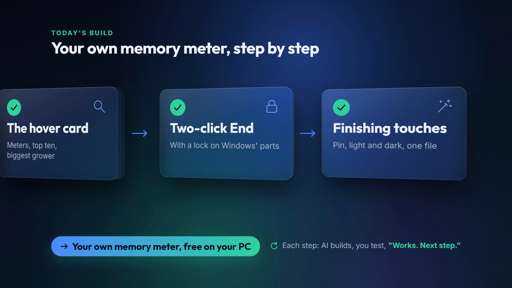

# Make an opener video for your AI app build

A skill that makes a short opener for a video about building an app with AI: six glass cards, one per build step, coming in over a dark glowing background. It always uses the same design, so every opener in your series looks and moves alike. It makes a 10-second silent preview first. When you send a recording of yourself reading the steps, it times each card to land on the word you say.

**You don't write any code**, and nothing costs money: it runs on your own computer with free tools, with no accounts.

> [!NOTE]
> **Made with Claude Code, works with any AI app.** We built ours with Claude Code. You can use any AI coding app you like, for example Antigravity, Codex or Cursor: the skill and the requests are the same.



## Start here

1. **Add the skill:** copy this folder into your AI app's skills folder.
   - Claude Code: `~/.claude/skills/app-opener-video/`
   - Codex: `~/.codex/skills/app-opener-video/`
   - Any other AI app that reads Agent Skills (a folder with a `SKILL.md`) works the same way.
2. **Have the free tools ready:** Python 3, Node.js and ffmpeg, plus the free faster-whisper speech-to-text for the voice version. Your AI app can install them for you; just ask.
3. **Ask for the preview,** for example:

   ```text
   Make the opener video for my habit tracker. The six steps are: set up, one message, log a habit, the streak calendar, reminders, and the weekly chart.
   ```

4. **Record your voice-over** reading the talk track it suggests, then send it:

   ```text
   Here's my voice-over for the opener. Time the cards to it.
   ```

## What's in here

| | |
|---|---|
| [SKILL.md](SKILL.md) | The instructions your AI reads: what's fixed, the preview, the voice version, the checks |
| [references/timing.md](references/timing.md) | How the cards are timed to your voice, with a sample talk track |
| [build_opener.py](build_opener.py) | Builds the video project from a small `opener.json` |
| [transcribe.py](transcribe.py) | Lists every word in your recording with the second it starts |
| [template/](template/) | The fixed design. The fonts are Inter and Outfit, under the SIL Open Font License; their license files are next to them |
| [example/](example/) | A preview and a voice-timed `opener.json` for a voice-typing app |
| [docs/](docs/) | The picture on this page |

Pairs well with [app-show-report](../app-show-report/), which turns the same build into a Show Map and a build-it-yourself kit.

## License

[MIT](../../LICENSE): use it, change it, share it. The fonts keep their own SIL Open Font License.
