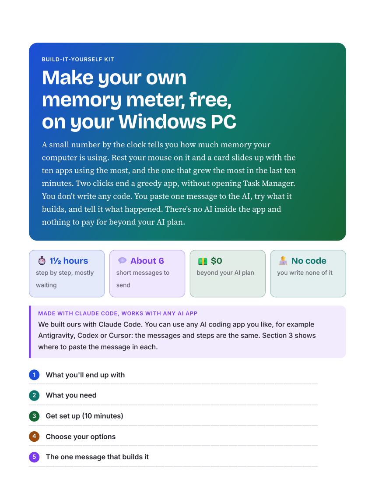

# Turn your AI-built app into a build-it-yourself kit

You built a small, useful app with AI, and it works. This skill has your AI go back over what really happened in that build and turn it into two documents:
- **A Show Map:** your script for filming or writing up the build again with the fewest messages. It covers what went wrong the first time, the steps to show, and notes for you.
- **A build-it-yourself kit:** a colorful, standalone guide with real screenshots, so anyone who has only ever typed into an AI chat can build the app for themselves.

**You don't write any code.** You ask for the report in the same conversation you built the app in, and check what comes back.

> [!NOTE]
> **Made with Claude Code, works with any AI app.** We built ours with Claude Code. You can use any AI coding app you like, for example Antigravity, Codex or Cursor: the skill and the requests are the same.



A finished kit made with this skill is in [glance](../../glance/) (see its [KIT.md](../../glance/KIT.md) and the printable [PDF](../../glance/docs/build-it-yourself-kit.pdf)).

## Start here

1. **Add the skill:** copy this folder into your AI app's skills folder.
   - Claude Code: `~/.claude/skills/app-show-report/`
   - Codex: `~/.codex/skills/app-show-report/`
   - Any other AI app that reads Agent Skills (a folder with a `SKILL.md`) works the same way.
2. **Once your app works,** ask in the same conversation you built it in, for example:

   ```text
   My habit tracker works. Make the show report for it: a show map I can film from, and a build-it-yourself kit people can follow.
   ```

3. **Check it, then share the kit.** You get both documents as web pages and PDFs. The kit never mentions your show, so you can hand it to anyone.

## What's in here

| | |
|---|---|
| [SKILL.md](SKILL.md) | The instructions your AI reads: gather the real facts first, then write both parts |
| [references/rules.md](references/rules.md) | The rules for both parts: plain words, "AI" rather than one brand, free local tools, real numbers, safety lines, nothing private |
| [references/outline.md](references/outline.md) | The sections of the Show Map and the kit, and the color and screenshot rules |
| [references/finish.md](references/finish.md) | Making the pages and PDFs, the checks before sharing, and the final checklist |
| [docs/](docs/) | The picture on this page |

Pairs well with [app-opener-video](../app-opener-video/), which makes a short opener video of the same build steps.

## License

[MIT](../../LICENSE): use it, change it, share it.
