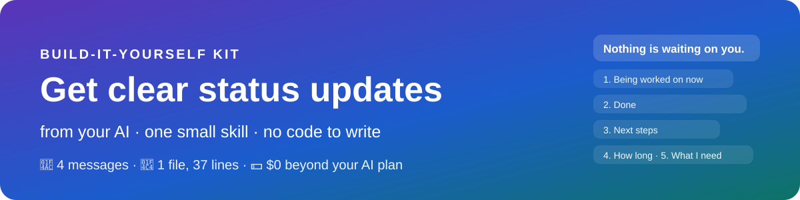
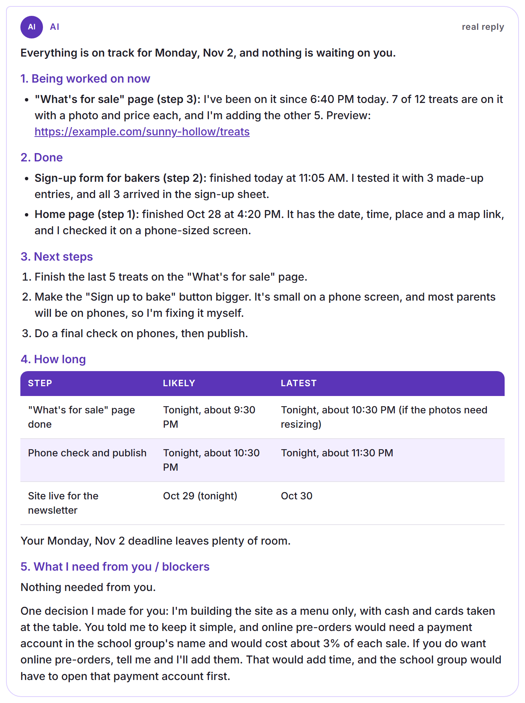
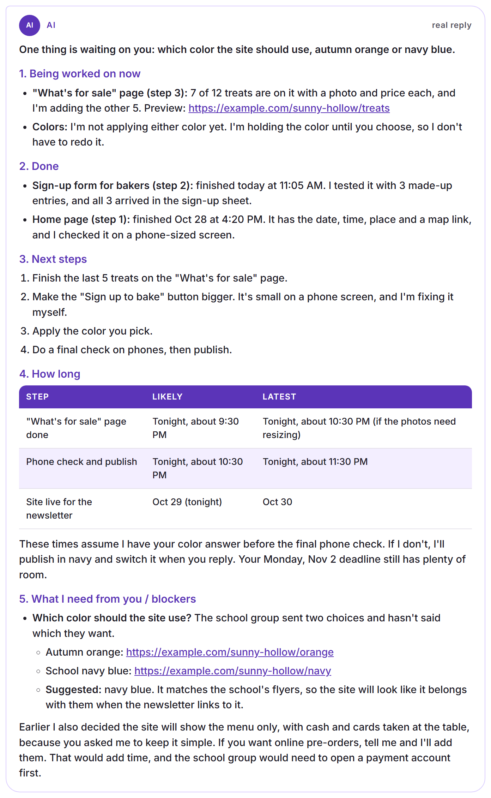
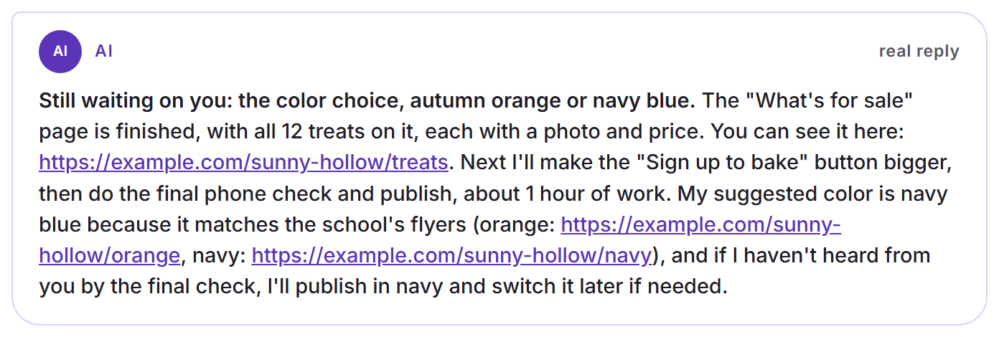

<p align="center"></p>

Add one small skill to your AI app, and every time you ask "where are we?", the answer comes the same way, in five parts: what's being worked on now, what's done, what's next, how long it will take, and what it needs from you. Every question comes written out with a suggested answer, and the AI shows you the actual thing instead of describing it. You don't write any code. You paste one message, start a new chat, and ask.

| 💬 4 | 📄 1 file | ⏱️ Under 30 s | 💵 $0 |
|:-:|:-:|:-:|:-:|
| messages to add it and try it | 37 lines of plain English | per reply in our tries (10 to 22 seconds) | beyond your AI plan |

> [!IMPORTANT]
> **Made with Claude Code, works with any AI app:** We built ours with Claude Code. You can use any AI coding app you like, for example Antigravity, Codex or Cursor: the messages and steps are the same. Section 3 shows where to paste the message in each.

**Contents**

1. [🎯 What you'll end up with](#1--what-youll-end-up-with)
2. [🧰 What you need](#2--what-you-need)
3. [🛠️ Get set up (10 minutes)](#3--get-set-up-10-minutes)
4. [🎨 Choose your options](#4--choose-your-options)
5. [💬 The one message that adds it](#5--the-one-message-that-adds-it)
6. [🧪 Try it](#6--try-it)
7. [✨ Make it your own](#7--make-it-your-own)
8. [🩹 When something goes wrong](#8--when-something-goes-wrong)
9. [🛡️ Stay safe](#9--stay-safe)
10. [🎁 Give it to a friend](#10--give-it-to-a-friend)
11. [📖 Words you'll hear](#11--words-youll-hear)

A printable copy of this kit is in [docs/status-update-kit.pdf](docs/status-update-kit.pdf).

## 1. 🎯 What you'll end up with

- **The same five parts, every time:** being worked on now, done (newest first, with times), next steps in order, how long (likely and latest, with dates in plain words), and what it needs from you.
- **A first line you can act on:** if anything is waiting on you, the first line says so, in bold.
- **Every question written out,** each with a suggested answer. Never "you have 6 questions".
- **The actual thing:** the picture, a link you can open, the number itself. Not a file path or a description.
- **Fewer questions:** if something you already said answers it, the AI decides and tells you in one line. It still asks about looks, publishing, money, deleting, passwords and anything sent in your name.
- **Short notes for small news:** one thing finished, or one problem, comes as 2 to 4 sentences.

<p align="center"><br><sub>A real reply to "Give me a status update." from an AI that has this skill. The project is made up.</sub></p>

It works for any project you build with AI: an app, a website, a spreadsheet, a trip plan. It's most useful when you check in from your phone, or come back to a chat after a while.

## 2. 🧰 What you need

- **A computer** with an AI app on it. We used a Windows PC; nothing here is Windows-only.
- **An AI app that can build on your computer:** one that can create files and run programs for you, not just chat, for example Antigravity, Claude Code, Codex or Cursor. Any of them works; nothing here is tied to one. You'll need a plan for it, if it needs one.
- No downloads, no accounts, and no code.

| Part | What it is | Cost |
|---|---|---|
| The skill | One text file, [SKILL.md](SKILL.md): 37 lines, 430 words, about 2.4 KB | $0 |
| Writing your updates | Your AI app, the same one you build with | Included in your plan |
| The practice project | A made-up bake sale website, as a message you paste | $0 |

> [!TIP]
> You never need a credit card, an API key or a new account for this.

## 3. 🛠️ Get set up (10 minutes)

1. **Install your AI app** and sign in. It must be one that can create files on your computer, not just chat.
2. **Open the part of your AI app that can work on your computer** (its agent). It's like the chat you know, but the AI can create files for you.
3. **Open a folder.** Any project you're working on, or a new empty one for practice, for example `C:\StatusPractice`.
4. **When the AI asks permission** to create the skill's folder and file, read the one-line description and allow it. Each app asks in its own way: an Allow button, or a setting for how much it may do without asking.

Where to paste the message in some popular AI coding apps, and where they keep skills. Their menus change often, so look for the same idea if yours looks different.

| If you use | Open a folder | Paste the message into | Where skills go |
|---|---|---|---|
| Antigravity | Open the folder as your workspace | A new conversation or task with the agent | Wherever it keeps skills or always-on rules. The message asks the AI to pick the right place. |
| Claude Code | In the Claude desktop app, open the Code tab and pick the folder; or type `claude` in a terminal inside the folder | The chat box | `~/.claude/skills/` for all your projects, or `.claude/skills/` inside one folder |
| Codex | In the Codex app, add the folder as a project; or type `codex` in a terminal inside the folder | The chat box | `~/.codex/skills/` |
| Cursor | File › Open Folder | The Agent chat in that same window | Wherever it keeps skills or rules. The message asks the AI to pick. |
| Something else | Any AI app that can create files in a folder on your computer | Wherever you talk to its agent | If it can't use skills, the message tells it to add the text to its always-on instructions instead |

## 4. 🎨 Choose your options

Write your answers into the [brackets] of the message in the next section.

| Choice | Suggested | Notes |
|---|---|---|
| Where it works | [all my projects] | Or [just this folder], to try it in one place first. You can move it later. |
| How you add it | Paste the message | The message carries the whole skill. If you downloaded this folder instead, use the shorter "from a download" message, and put where it is in [my Downloads folder]. |
| Practice first | Yes | The made-up bake sale project in section 6 lets you see every part before you use it on real work. |

> [!NOTE]
> You can change how it writes later, for example shorter updates or your time zone. Section 7 has the messages.

## 5. 💬 The one message that adds it

Change the [brackets] and paste it into your AI app. It includes the whole skill, between two marker lines, so the AI can save it exactly. (It's also in [prompts/add-the-skill.txt](prompts/add-the-skill.txt).)

```text
Add a skill for me called status-update. A skill is a set of instructions you keep and follow whenever that job comes up.
- Make a new folder named status-update in the place where you load skills for [all my projects]. Save the text between the two marker lines below in it as a file named SKILL.md, exactly as written. Don't change the text.
- If you can't use skills, add the same text to your always-on instructions for [all my projects] instead.
- Don't change anything else.
- Then tell me in one line where you saved it. After that I'll start a new chat, so you load the skill.

----- START OF SKILL.md -----
---
name: status-update
description: Write any status update, progress report, wrap-up or question for a busy, non-technical owner in a fixed five-part format - being worked on now / done / next / how long / what I need from you - with every question spelled out with a suggested answer and the actual thing shown. Use whenever you report progress, ask the owner to decide anything, or they ask "status", "where are we", "what's waiting on me".
---

# Five-part status update

The reader is busy, not technical, and often on a phone, sometimes in a chat they didn't start. Write so they can act without hunting.

## The five parts, in this order, every time
1. **Being worked on now:** each task or helper, and what it's doing right now, in plain words.
2. **Done:** most recent first, with times.
3. **Next steps:** in order.
4. **How long:** a small table of `Likely / Latest` for each next step and the overall goal. Dates in plain words ("Oct 30").
5. **What I need from you / blockers:** every question written out in full, each with a **Suggested:** answer. Never a count ("6 questions"). If there's nothing, write "Nothing needed from you."

If anything is waiting on the reader, also say so in **bold in the first line**.

A single-event note (one thing finished, one problem) may be 2 to 4 sentences. Anything that reads as a status, a wrap-up, or more than one event uses all five parts.

## Show the actual thing
- **Pictures:** attach them in the same message.
- **Documents:** a link they can open, never a file path.
- **Numbers:** the numbers themselves.
- If something was sent earlier and is still waiting, send it again.

## Decide what you can
Before asking, check whether the owner's stated goal, or a decision they already made, answers the question. If it does, decide, and report it in one line. Ask only the genuinely open choices: product or visual choices, releases, spending, deletions, credentials, and messages sent in their name.

## Words
- Plain English, with what it means for them first. Technical identifiers (commit IDs, ticket numbers, paths) go at the end, if at all.
- No jargon: write "merged into the main code, not live yet", not "squash-merged to main".
- Be honest: say what failed and what you couldn't check, and own any mistake in one sentence.

## Before sending
- Check the real clock before writing any time.
- Every question has a suggested answer, and the thing it's about is shown.
----- END OF SKILL.md -----
```

The AI saves the file and tells you in one line where it put it. In our test, the saved copy matched the text exactly.

> [!IMPORTANT]
> **Then start a new chat.** Most AI apps load skills when a chat starts. Open a new chat (or a new session) in the same folder before you try it.

Already downloaded this folder? Paste this shorter message instead:

```text
I downloaded a skill folder named status-update. It's in [my Downloads folder]. Copy the whole folder, without changing anything in it, into the place where you load skills for [all my projects]. If you can't use skills, add the text of its SKILL.md to your always-on instructions for [all my projects] instead. Then tell me in one line where it is now. After that I'll start a new chat, so you load the skill.
```

## 6. 🧪 Try it

Three practice messages use a made-up project, so you can see every part before you rely on it. Paste each one in the new chat, read the reply, and check it against "what to look for". Then try it on your own work.

### Step 1 · Ask for a status

Paste the practice project. It's a bake sale website with two finished steps, one in progress and one open question.

```text
Let's practice. Pretend you're the AI building a small website for me, and these are your own project notes. Then answer my request at the bottom.

PROJECT NOTES (all made up)
- The project: a website for the Sunny Hollow School fall bake sale. The sale is Saturday, Nov 7, 9 AM to noon, in the school gym. I want the site live by Monday, Nov 2, so the school newsletter can link to it.
- What I told you at the start: "Keep it simple. Most parents will open it on their phones."
- Step 1, finished Oct 28 at 4:20 PM: the home page, with the date, time, place and a map link. Checked on a phone-sized screen.
- Step 2, finished today at 11:05 AM: the sign-up form for bakers. Tested with 3 made-up entries; all 3 arrived in the sign-up sheet.
- Step 3, in progress since 6:40 PM today: the "What's for sale" page, with a photo and price for each treat. 7 of 12 treats are on it. Preview: https://example.com/sunny-hollow/treats. About 1 more hour, up to 2 if the photos need resizing.
- Step 4, not started: a final check on phones, then publish. About 1 hour.
- Noticed today: the "Sign up to bake" button is small on a phone screen.
- Open question: should the site take pre-orders with online payment, or just show the menu and take cash and cards at the table? Online payment needs a payment account in the school group's name, and the payment service keeps about 3% of each sale.

Give me a status update.
```

**What to look for:** a bold first line that says whether anything waits on you; the five parts in order; times in a likely and latest table; the preview link; and one line where it settled the payment question itself, because you'd asked it to keep things simple. The real reply is the picture in section 1.

### Step 2 · Give it a choice only you can make

Send a new note: two color choices nobody has picked yet. Looks are always yours to decide.

```text
New note for your project: the school group sent two color choices for the site and hasn't said which they want: autumn orange (preview: https://example.com/sunny-hollow/orange) or the school's navy blue (preview: https://example.com/sunny-hollow/navy). The navy matches the school's flyers. What's waiting on me?
```

**What to look for:** the first line says what's waiting; the question is written out in full, with both previews and a **Suggested** answer.

<p align="center"><br><sub>A real reply: the first line says what's waiting, and the question comes written out, with both previews and a suggested answer.</sub></p>

### Step 3 · A one-event note

Pretend one thing just finished.

```text
Pretend the "What's for sale" page just finished, with all 12 treats on it. Send me the short note you'd send when one thing finishes.
```

**What to look for:** 2 to 4 sentences, not five parts. Anything still waiting on you is still in the first line.

<p align="center"><br><sub>A real reply: one thing finished, so a few sentences instead of five parts, and the open question is still in front.</sub></p>

### Step 4 · Your own work

In a chat where the AI has been working on something real, just ask:

```text
Give me a status update.
```

Also try "Where are we?" and "What's waiting on me?". From now on, the AI also uses this format by itself when it wraps up or needs a decision from you.

## 7. ✨ Make it your own

The skill is a plain text file, so you change it by asking. Some starting points:

| You want | Say to the AI |
|---|---|
| Shorter updates on your phone | "Change my status-update skill: keep each of the five parts to three lines at most." |
| Times in your time zone | "Change my status-update skill: always write times in Eastern time, and say so." |
| To decide more for you | "Change my status-update skill: only ask me about money, deleting things and anything sent in my name. Decide the rest and tell me in one line." |
| To be asked more | "Change my status-update skill: ask me before deciding anything that costs money, even when you think my goal answers it." |
| A sixth part | "Add a sixth part to my status-update skill, 'Risks', after 'How long'." |
| Your spelling | "Change my status-update skill: use American English spelling everywhere." (Or British, or any language.) |
| It only when you ask | "Change my status-update skill: use the five parts only when I ask for a status. Keep other replies short." |
| Another phrase to start it | "Change my status-update skill so that 'catch me up' also gets the five parts." |

> [!TIP]
> Say "save a copy of my status-update skill first" before a change, so you can go back. Ask for one change at a time, start a new chat, then ask for a status to see it.

## 8. 🩹 When something goes wrong

Say what you asked and what came back. Most things take one message.

| What happens | Say to the AI |
|---|---|
| The reply doesn't use the five parts | Start a new chat first. If it still doesn't: "Where did you save the status-update skill? Can you see it in this chat?" |
| It isn't sure whether you need a new chat | Start one anyway. It costs nothing, and skills load when a chat starts. |
| It gives a count ("you have 3 questions") | "Write out each question in full, with a suggested answer." |
| It names a file instead of showing it | "Show me the picture here," or "give me a link I can open." |
| The times look wrong | "Check the clock, then fix the times in that update." |
| It uses words you don't know | "Say that again in plain words, with what it means for me first." |
| It decided something you wanted to decide | "Next time, ask me about that kind of choice. Add it to my status-update skill." |
| A small piece of news came as a long report | "That was one event. Keep notes like that to 2 to 4 sentences." |
| It says "done" but you can't see it | "Show me the finished thing: a picture or a link I can open." |

## 9. 🛡️ Stay safe

- **It's only words.** The skill changes how the AI writes to you. It doesn't let the AI do anything it couldn't do before.
- **Read any skill before you add it.** This one is 37 lines of plain English, all shown in section 5. A skill from someone you don't know could ask your AI to do things you don't want.
- **Big choices stay yours.** The skill tells the AI to ask about looks, publishing, money, deleting, passwords and messages sent in your name. If it ever decides one of those without asking, say so (section 8).
- **"Done" is the AI's word.** Open the link or picture it shows you before you rely on it, especially before anything goes public.
- **Practice with made-up data.** Never paste passwords or private details into a practice message.
- **Keep a copy** of the skill before you change it.

## 10. 🎁 Give it to a friend

The easiest way is to send them this kit: the message in section 5 holds the whole skill. Or ask your AI for a zip of the folder:

```text
Make a zip of my status-update skill folder so I can send it to a friend. Put only that folder in it, with nothing of mine added. Then tell me in one line where the zip is.
```

> [!NOTE]
> If you changed the skill, read it once before you share it, in case you added anything personal (a name, a time zone, a private link).

## 11. 📖 Words you'll hear

- **Skill:** A set of instructions your AI keeps and follows whenever that job comes up. It's a folder with one text file in it.
- **SKILL.md:** That text file. The part at the top (between the two `---` lines) tells the AI when to use it; the rest says how.
- **Skills folder:** Where your AI app looks for skills. Some apps have one for all your projects and one inside each project folder.
- **Always-on instructions:** A file your AI app reads at the start of every chat in a folder, for apps that don't use skills.
- **Status update:** A short report of where a piece of work stands.
- **Blocker:** Something that stops work until someone acts, often a decision only you can make.
- **Likely / Latest:** When something should be done, and the latest it should take if things go wrong.
- **AI coding app:** An AI app that can create files and run programs in a folder on your computer, for example Antigravity, Claude Code, Codex or Cursor.
- **Prompt:** A message you type to the AI.
