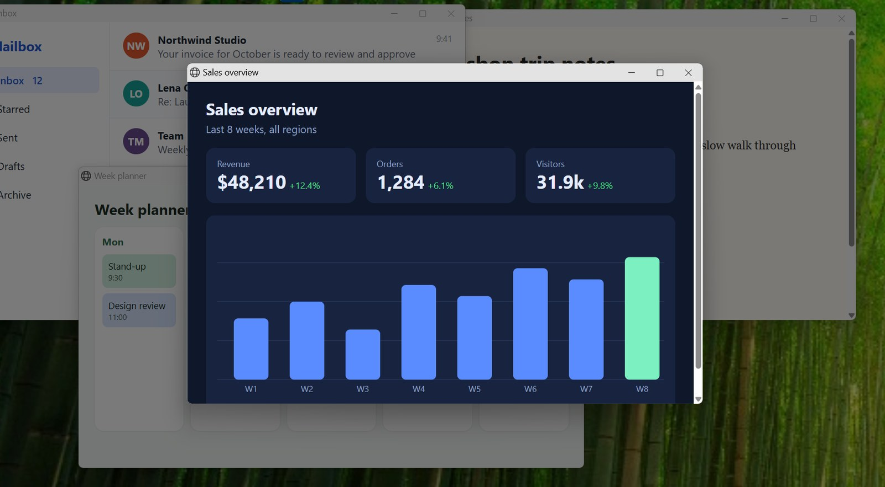
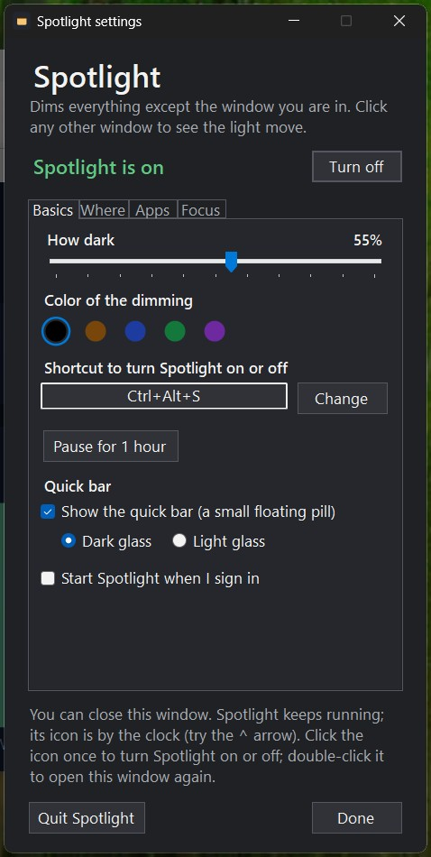
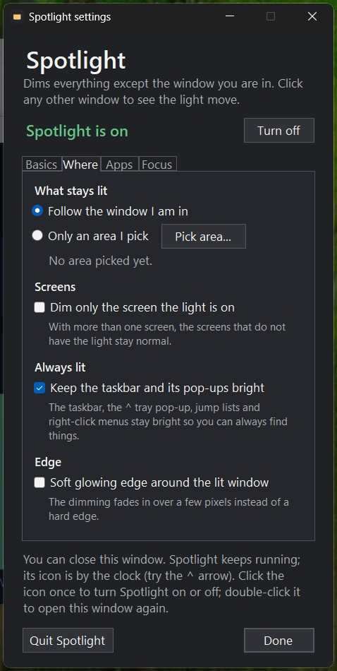
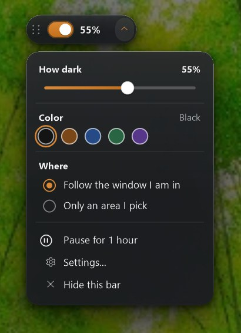
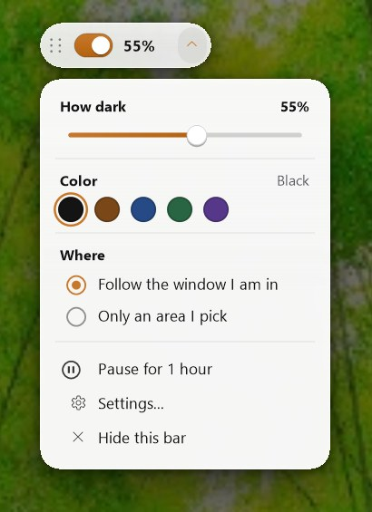
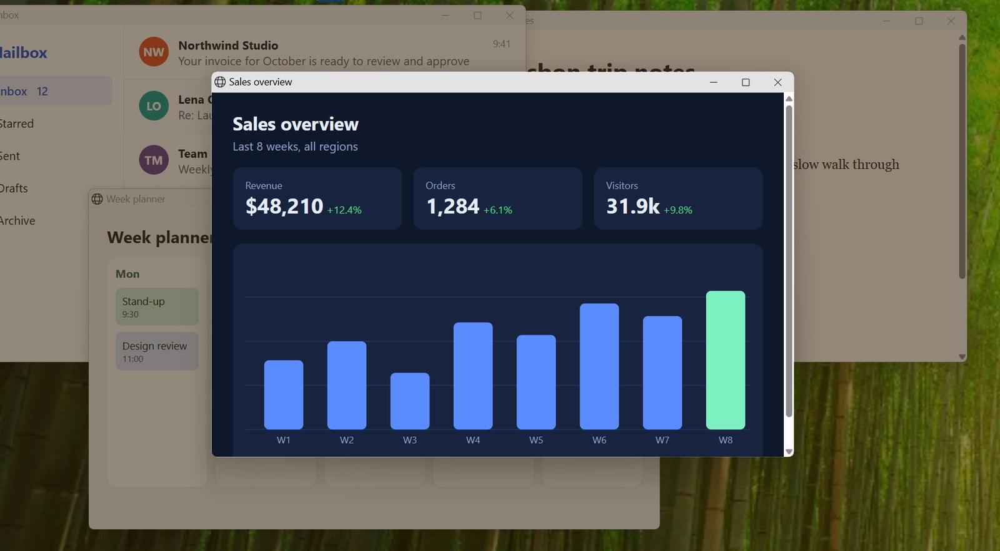
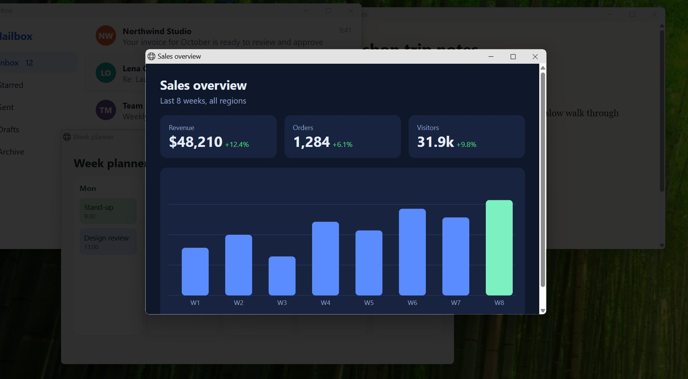
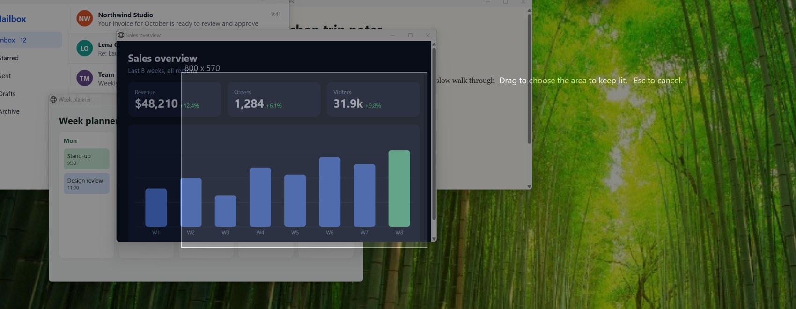
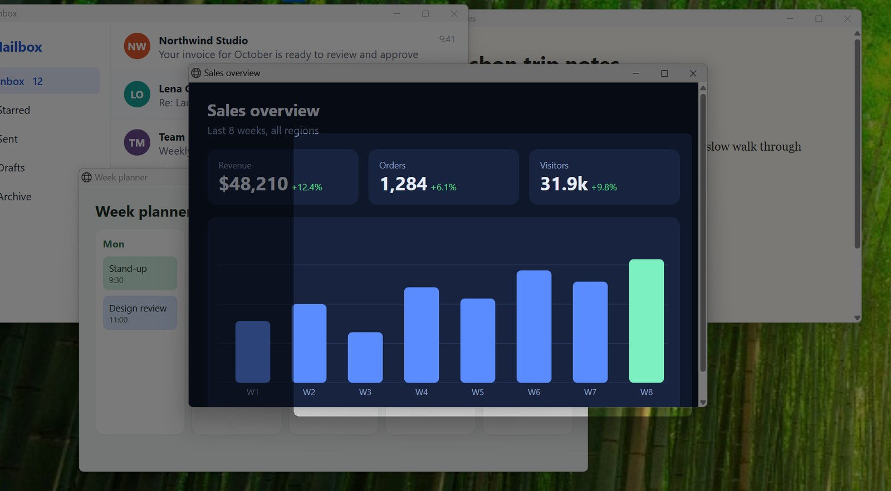
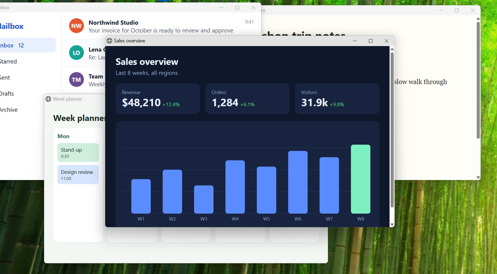

# Build your own Spotlight

A tiny Windows app that dims everything on every screen except the window you are working in. Click another window and the light glides to it. You build it by talking to an AI, no coding.

| Cost | Needs | App size | Coding |
|:-:|:-:|:-:|:-:|
| **$0 beyond your AI plan** | **A Windows 11 PC** | **About 50 MB** | **None: you chat** |

> [!NOTE]
> **Made with Claude Code, works with any AI app.** We built ours with Claude Code. You can use any AI coding app you like, for example Antigravity, Codex or Cursor: the messages and steps are the same. Section 3 shows where to paste the message in each.

## 1. What you'll end up with



*The finished app: one window stays bright, everything else on every screen is dimmed. These pictures use made-up sample windows.*

- **The light follows you.** Click a window and the light glides to it; drag or resize it and the light moves with it, even with rounded corners and snapped windows.
- **It stays out of the way.** The desktop, the Start menu, Alt+Tab and full-screen videos are never dimmed. You can click and type straight through the dimming; it never takes focus.
- **You choose how it looks.** A "How dark" slider from 0 to 100%, five colors for the dimming, an optional soft glowing edge.
- **Pick an area like a snip.** Drag a rectangle and only that area stays lit, whichever window you use.
- **A small floating quick bar.** A glass pill (dark or light, your choice) with the on/off switch and the dimming percent. Drag it anywhere by its grip. Click it to drop down a panel with How dark, Color, Where, Pause, Settings and Hide, so you rarely need the settings window. It never steals focus and hides itself for full-screen apps.
- **One click or one key.** Click the tray icon (by the clock) to turn it on or off, or press Ctrl+Alt+S (you can change the keys). Pause it for an hour when you want normal brightness.
- **Handy extras (all optional):** never dim around chosen programs, step aside for video-meeting apps, keep the taskbar and pop-up menus bright, light notification pop-ups (this one is not yet verified on a real PC), hide the dimming from screen sharing, dim only the screen the light is on.
- **A real Windows installer** with an uninstaller that cleans up after itself, and a settings window.



*The settings window, Basics tab: on/off, "How dark", color, the shortcut, pause.*



*The Where tab: follow the window or pick an area, one screen only, soft edge, taskbar bright.*



*The quick bar in its dark look, with its panel open.*



*The same bar in its light look. The settings window matches whichever you pick.*

## 2. What you need

| Part | What runs it | Cost |
|---|---|---|
| A Windows 11 PC | Your own computer | You have it |
| An AI app that can build on your computer: one that can create files and run programs for you, not just chat | Your AI app | $0 beyond your AI plan (a paid plan for it, if it needs one) |
| Microsoft's free .NET tools (the AI installs them for you, with your OK) | Your computer | Free; a few hundred MB of disk |
| Inno Setup, the free tool that makes the installer (the AI installs it with your OK) | Your computer | Free |
| Windows Sandbox (optional, for testing the install safely) | Windows 11 Pro | Free, turn it on in Windows features |

> [!NOTE]
> Any of the AI apps works; nothing here is tied to one. The finished app uses no internet, no accounts and no paid services. It keeps only its own files in its own folder: a small settings file, a small log and, if the settings file is ever damaged, a backup copy of it.

## 3. Get set up (10 minutes)

1. Install your AI app and sign in.
2. Make an empty folder, for example `Documents\Spotlight-build`.
3. Open that folder in your AI app, in the part that can work on your computer.
4. When it asks for permission to create files or run programs, allow it. That is how it builds for you.

| AI app | Where to open your folder | Where to paste the message |
|---|---|---|
| Antigravity | File, Open Folder | The agent chat panel |
| Claude Code | Open the folder in its Code tab (or run it in a terminal inside the folder) | The message box at the bottom |
| Codex | Open the folder as your project | The task or chat box |
| Cursor | File, Open Folder | The Agent chat (Ctrl+L) |

## 4. Choose your options

Fill the [brackets] in the message in section 5 with your choices. Not sure? Use the suggestion.

| Choice | Suggested | Note |
|---|---|---|
| [APP NAME] | Spotlight | Shows in the Start menu, the Apps list and the tray tooltip. |
| [HOTKEY] | Ctrl+Alt+S | Must use Ctrl, Alt or the Windows key plus a letter, number or F-key, so it can never block normal typing. |
| [DEFAULT DARKNESS] | 55% | 0 means no dimming, 100% means a full blackout. |
| [COLORS] | Black, Warm, Blue, Green, Purple | All dark, soft shades; the color of the dimming, not a bright tint. |
| [EXTRAS] | All of them | Pause for an hour, pick an area, never-dim list, meeting apps, taskbar always lit, notification pop-ups lit, hide from screen sharing, one screen only, soft edge. Say "none" for the simplest version. |
| [QUICK BAR] | On, with a dark and a light look | The small floating pill. Say "none" to leave it out. The settings window takes the same dark or light look. |
| [START WITH WINDOWS] | Off, with a tick box to turn it on | Uses the normal Windows startup list so you can also switch it off in Task Manager. |

## 5. The one message that builds it

Paste this into your AI app. It settles every decision and has the lessons from our first build already inside.

**Copy this and paste it to your AI:**

```text
Build me a small free Windows 11 app called [APP NAME], in C# with .NET and Windows Forms, as a single-file self-contained exe plus a professional per-user installer (Inno Setup, no admin needed).

WHAT IT DOES: it dims everything on every monitor except the window I am working in. When I click another window the light glides to it (about 0.25 s, with a short fade in and out). It runs from a tray icon (no main window). Clicks, typing and scrolling must go straight through the dimming and it must never take focus or show in Alt+Tab.

HOW TO BUILD IT (lessons we already learned, keep them):
- One solid-black, see-through, click-through, topmost window per monitor, and cut the "light" out of it with a window region (a hole shaped like the active window, rounded like Windows 11 windows, square when maximized). Moving the light is then only a new region, so it uses almost no CPU. Do not redraw bitmaps every frame.
- Make each dimming window ONE PIXEL ROW SHORTER than its monitor. A window that covers a whole screen makes Windows think a full-screen app is running and it switches on Do Not Disturb by itself.
- Follow windows with Windows event hooks (foreground change, minimize, destroy), never with a polling loop; attach the "location changed" hook only to the lit window's thread. Keep the delegate in a field so it is never garbage-collected. If a hook fails, fall back to a slow poll and tell me once.
- Use the visible frame (DWMWA_EXTENDED_FRAME_BOUNDS), not GetWindowRect, which includes invisible resize borders.
- Do not dim: the desktop, Start, search, Alt+Tab, full-screen apps (a window with no title bar that covers a monitor), minimized windows. Keep the old light while the taskbar has focus. When a full-screen app returns to normal, bring the dimming back by itself.
- Keep every decision (where the hole goes, which window to light, the glide math) in plain classes with no Windows calls, so you can test them with made-up monitors and windows.
- Support several monitors with different scaling; rebuild on display changes.

CONTROLS: tray icon: one click turns it on or off (gray icon when off), double-click opens a settings window, right-click shows a short menu. Hotkey [HOTKEY] toggles it. Settings window with tabs: Basics (on/off button, a "How dark" slider 0 to 100 with live preview and a default of [DEFAULT DARKNESS]%, dimming color choices [COLORS], a Change button to record a new shortcut that refuses keys that would block typing and keys another program already owns, Pause for 1 hour, Start when I sign in [START WITH WINDOWS]); Where (follow the window, or "only an area I pick": a see-through selection sheet over all screens where I drag a rectangle, Esc cancels; dim only the screen the light is on; soft glowing edge; keep the taskbar, tray pop-up and menus lit); Apps (a list of programs to never dim around); Focus (keep notification pop-ups lit, step aside for video-meeting apps, hide the dimming from screen sharing). The settings window is its own short-lived copy of the exe so it is lit like any window, and it must close by itself if the tray copy quits. Size the tabs to fit at any display scale (a fixed height cut the last option off at 125%).
QUICK BAR [QUICK BAR]: a small floating glass pill (a see-through, always-on-top window drawn by the app itself, never taking focus, kept above the dimming, hidden while a full-screen app is in front) with a drag grip (it snaps gently to screen edges and remembers where it was left), the on/off switch, the dimming percent and a chevron that opens a panel UNDER the pill (above it only if there is no room below) with How dark (a slider), Color, Where, Pause 1 hour, Settings and Hide this bar. Give it a dark smoked-glass look and a light frosted-glass look, with a soft shadow in its own click-through window so a click in the shadow reaches the window underneath. The settings window follows the same look and opens right under the pill when started from it.
EXTRAS I WANT: [EXTRAS]

SAVING: only its own files in %LocalAppData%\[APP NAME] (settings.json, a small log, and settings.bad.json as a copy of a damaged settings file) plus the per-user startup entry when I tick Start at sign-in; write settings.json by saving a new file beside it and swapping it in, so nobody reads half a file; if one field is damaged keep all the others, keep a copy of the damaged file as settings.bad.json and tell me once; never write anything else.

SAFETY AND TESTING:
- Tests and any test run must never take screenshots of my real screen, press real keys, register the real hotkey, or touch my real settings or startup entry. Give test copies their own names for the lock, the settings folder and the startup entry (an environment variable).
- Build in a copy of the folder and swap it in only when the tests pass. Nothing may fail silently: log repeats once.
- Write headless tests for the geometry, the window rules, the glide, the hotkey and the settings (all with made-up data) and run them. Then build the installer; its uninstaller must quit the running copy first, wait for it, and remove the settings, the Start menu shortcut and the startup entry. If anything is still running, including a picking sheet that was open, the installer stops it.
- When done, give me the installer path, a one-page how-to-use, and a test checklist for trying it in Windows Sandbox.

Work step by step in this order, and after each step tell me in two lines what I can try, then wait for me to say "Works. Next step.":
1. The dimming and the glide between windows.
2. What it must skip (desktop, Start, Alt+Tab, full-screen apps) and what it must keep bright.
3. The tray icon (one click on or off, gray when off, double-click for settings), the hotkey and the right-click menu.
4. The settings window: Basics, Where, Apps and Focus, with the slider, colors, pause and the quick bar choices.
5. Pick an area like a snip.
6. The extras I chose.
7. The quick bar (the small glass pill with its panel, dark and light looks).
8. The installer and uninstaller, then the test checklist for Windows Sandbox.
```

**All in one go:** add this to the end of the message: "Do not stop between steps. Build everything, run all the tests, build the installer, and only then tell me what to try."

## 6. Try each step

After each step the AI tells you what to try. If it works, just say **"Works. Next step."** If something is off, say what you saw in plain words.

| Step | What to try (under two minutes) |
|---|---|
| 1. The dimming and the glide | Open three or four windows, click each one. The others should fade dark and the light should glide to the one you click. Drag it: the light follows. |
| 2. What it must skip | Click the desktop, open Start, press Alt+Tab, play a video full screen: no dimming. Leave full screen: the dimming comes back by itself. |
| 3. The tray icon and hotkey | Click the tray icon (look under the ^ arrow): it turns off and the icon goes gray. Click again. Press your hotkey. |
| 4. The settings window | Double-click the tray icon. Drag "How dark": the other windows change live. Try a color and "Pause for 1 hour". |
| 5. Pick an area | On the Where tab choose "Only an area I pick", drag a rectangle. Click other windows: the light stays on your area. Esc cancels the picking. |
| 6. The extras | Soft edge: the lit window's edge fades. Taskbar: it stays bright. Add a program to the never-dim list and click it: no dimming. |
| 7. The quick bar | Look for the small pill (it starts at the top center). Click its switch, click the pill to open the panel, drag the grip, hide it and bring it back from the tray menu, and try the dark and light looks in Settings. |
| 8. Installer | Run the installer (Windows may warn about an unsigned app: More info, then Run anyway). Check the Start menu, then uninstall: nothing should be left. |



*Step 4: the Warm color for the dimming.*



*Step 4: "How dark" turned up to 85%.*



*Step 5: the selection sheet while you drag.*



*Step 5: only the picked area stays lit.*



*Step 3: turned off with one click on the tray icon: nothing is dimmed.*

## 7. Make it your own

| You want | Say to the AI |
|---|---|
| A different shortcut | "Change the default hotkey to Ctrl+Alt+D." |
| A different default darkness | "Make the default 40%." |
| More colors | "Add a Red and a Gray color for the dimming, dark and soft." |
| Faster or slower glide | "Make the glide twice as fast" or "no glide, just a quick fade". |
| A smaller or bigger glowing edge | "Make the soft edge 40 pixels wide." |
| More meeting apps | "Add Discord and Slack calls to the meeting apps list." |
| A different icon or name | "Draw a new icon: a white window on a dark tile" and "Rename the app to Dimmer everywhere." |
| A different pill look | "Make the quick bar smaller" or "Add a third look, frosted blue." |
| Fewer features | "Remove pick-an-area and the Apps tab. Keep it simple." |
| Where settings are saved | "Tell me exactly where the settings file is, and make a portable version that keeps it next to the exe." |

## 8. When something goes wrong

| What happens | Say to the AI |
|---|---|
| After leaving a full-screen video the dimming does not come back | "When a full-screen window goes back to normal, light it again by itself. Keep watching its size after it is cleared." |
| A window that opens while the taskbar has focus is not lit until I click it | "Windows sometimes sends no focus event. While the taskbar has focus or nothing is lit, check the front window a few times a second, and stop checking when a normal window is lit." |
| Windows turns on Do Not Disturb the moment the app starts | "Windows thinks the dimming windows are a full-screen app. Make each one a pixel row shorter than its screen." |
| The taskbar, the ^ pop-up or right-click menus are dim and hard to see | "Keep the taskbar, its pop-ups and menus lit: add them as extra holes in the dimming, and look for them only while something is dimmed." |
| The last option in a settings tab is cut off on my screen | "Size the tabs to fit their content at this display scale, and let the pages scroll if the screen is too short." |
| The installer hangs or says a file is in use | "The uninstaller and installer must quit every copy, including the settings window, wait for it, and stop any copy that refuses." |
| Notification pop-ups are still dim | "Tell me the window class, program and size of a notification pop-up on this PC, then update the rule that lights them." |
| The settings file gets damaged and I lose my choices | "Save the settings file by writing a new file and swapping it in, keep every field that still reads, and keep a copy of the damaged file." |
| A leftover sheet or window keeps the uninstaller from finishing | "Every window of the app must close when the main copy quits, and the uninstaller must stop anything that is still running." |
| The hotkey does nothing | "Another program may own it. Tell me, and let me record a different one that is not taken." |

## 9. Stay safe

- **Your files:** the app keeps only its own files in its own folder: a small settings file, a small log and a backup copy if the settings file is ever damaged (plus a Windows startup entry if you turn on Start at sign-in). Back up your choices by copying `%LocalAppData%\[APP NAME]\settings.json`.
- **Tests never touch your screen:** the tests use made-up windows and screens. Only try the real app yourself, or in Windows Sandbox.
- **Trusted downloads only:** the installer you build is unsigned, so Windows warns about it. That is normal for something you made. Only run installers you built or trust.
- **Screen sharing:** turn on "Hide the dimming from screen sharing" if you do not want others to see the dimming.
- **Privacy:** no internet, no accounts, no tracking.

## 10. Give it to a friend

To hand the installer to someone else, ask your AI for a clean, offline, one-click version and test it first in Windows Sandbox.

**Copy this and paste it to your AI:**

```text
Make a friend version of [APP NAME]: one installer exe that works offline with no accounts, no private data and none of my settings inside. Test it in Windows Sandbox with no network: install it by double-clicking, check the first run opens the settings window, check turning it on and off, then uninstall and confirm nothing is left in the Start menu, the Apps list, the startup list or the settings folder. Write down every step you took, with pictures, and fix anything a first-time user would trip over.
```

## 11. Words you'll hear

| Word | Plain meaning |
|---|---|
| AI coding app | An AI program that can create files and run programs on your computer for you. Antigravity, Claude Code, Codex and Cursor are examples. |
| Tray icon | The little icons by the clock. New ones may hide under the ^ arrow. |
| Overlay | A see-through window laid over the screen, here the dimming. |
| Hotkey | A key combination that works from anywhere, like Ctrl+Alt+S. |
| Installer | The file you run once to put an app on a computer. |
| Windows Sandbox | A throwaway Windows inside Windows. Nothing you do there stays. |
| Do Not Disturb | A Windows mode that hides notification pop-ups. |
| Unsigned | Not stamped by a paid publisher, so Windows shows a warning. Fine for your own app. |

Free to use and change. Built and tested with made-up sample windows; no personal data appears in any picture.
