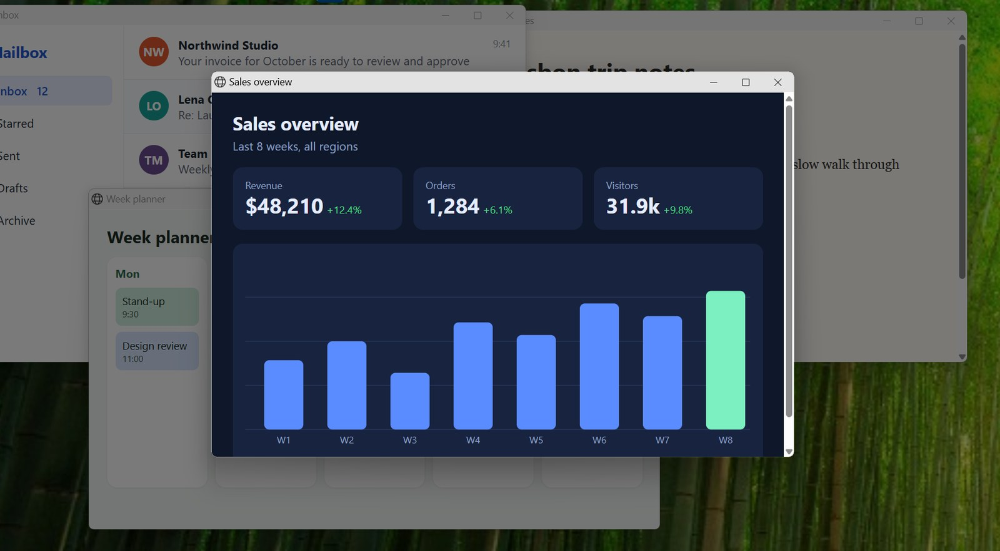

# Spotlight

Dims everything on every screen except the window you are working in. Click another window and the light glides to it. Free, local and private: a small Windows 11 app, open source (MIT).

> [!NOTE]
> **Made with Claude Code, works with any AI app.** We built ours with Claude Code. You can use any AI coding app you like, for example Antigravity, Codex or Cursor: the messages and steps are the same.

## What it does

- **The light follows you.** Click, drag, resize, snap or maximize a window and the light goes with it.
- **It stays out of the way.** Clicks, typing and scrolling go straight through the dimming; the desktop, Start, Alt+Tab and full-screen apps are never dimmed.
- **A small floating quick bar** (dark or light glass): the on/off switch, how dark, and a drop-down panel for color, where, pause and settings. Drag it anywhere.
- **Your choices:** how dark (0 to 100%), five dimming colors, a soft glowing edge, pick an area like a snip, pause for an hour, never dim around chosen programs, step aside for meeting apps, keep the taskbar and pop-ups bright, hide the dimming from screen sharing.
- **One click or one key:** click the tray icon (by the clock) to turn it on or off, double-click for settings, or press Ctrl+Alt+S (changeable).

## Get it

- **Use it:** download `Spotlight-Setup-1.3.0.exe` from the [Spotlight 1.3.0 release](https://github.com/petercarter19-hue/Apps/releases/tag/spotlight-v1.3.0) (the page lists its SHA-256 so you can check the file). The installer is not signed, so Windows shows a "protected your PC" box: choose More info, then Run anyway. Uninstall cleans up after itself.
- **Build it yourself with AI, no coding:** read the [kit](KIT.md) (or the printable [PDF](docs/build-it-yourself-kit.pdf)) and paste the message in [prompts/kickoff.txt](prompts/kickoff.txt).
- **Build the finished code:** see [AGENTS.md](AGENTS.md). In short: `powershell -ExecutionPolicy Bypass -File tools\build.ps1` (needs the free .NET 10 SDK; Inno Setup 6 for the installer). Tests: `dotnet run --project tests -c Release`.

## Local data (what it reads and writes)

- **Reads:** the position, size and state of the windows on your screens, the program names of running windows (the Apps tab list, the never-dim list and the meeting-apps option), and your screen layout. There is no network code: nothing leaves your computer.
- **Writes:** only its own files in `%LocalAppData%\Spotlight` (`settings.json`, `settings.bad.json` if the settings file was ever damaged, `log.txt`, and `settings.json.tmp` for a moment while saving) and, if you tick "Start at sign-in", one entry in your per-user Windows startup list. No admin rights.
- **Not verified yet:** lighting Windows notification pop-ups and setups with several screens of different scaling. Please open an issue if something is off.

## License

MIT, see [LICENSE](LICENSE).
