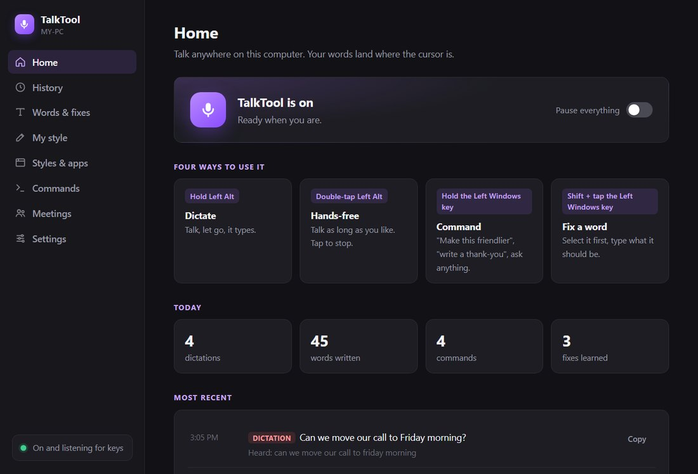
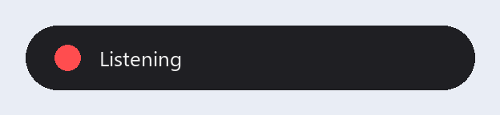
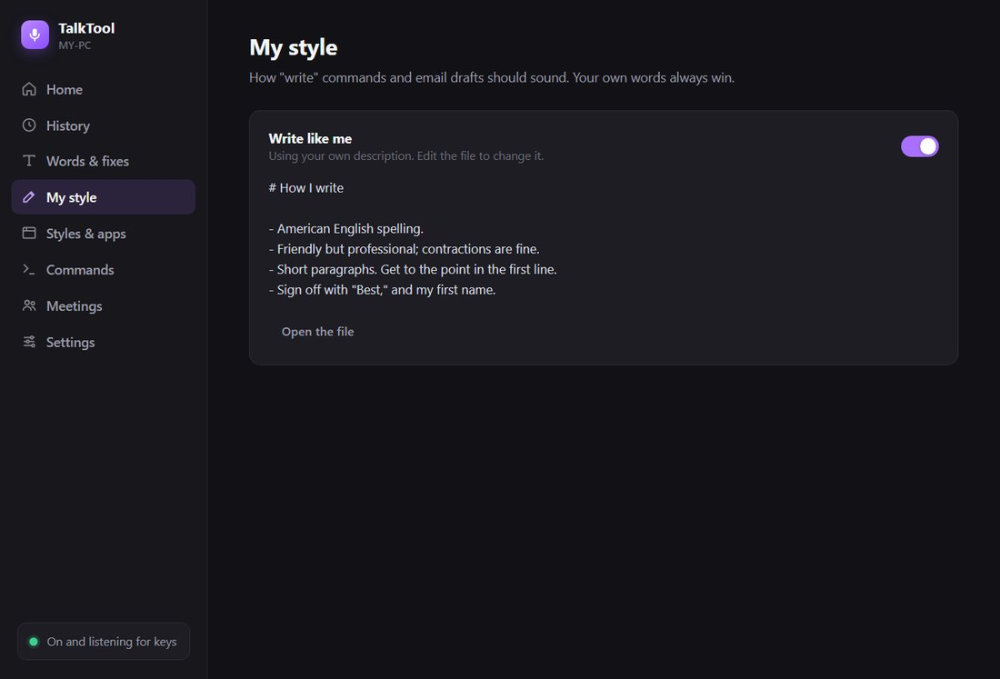
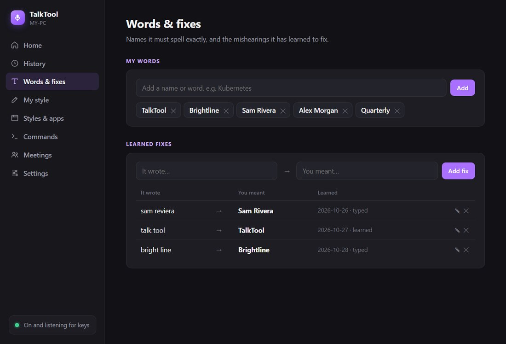
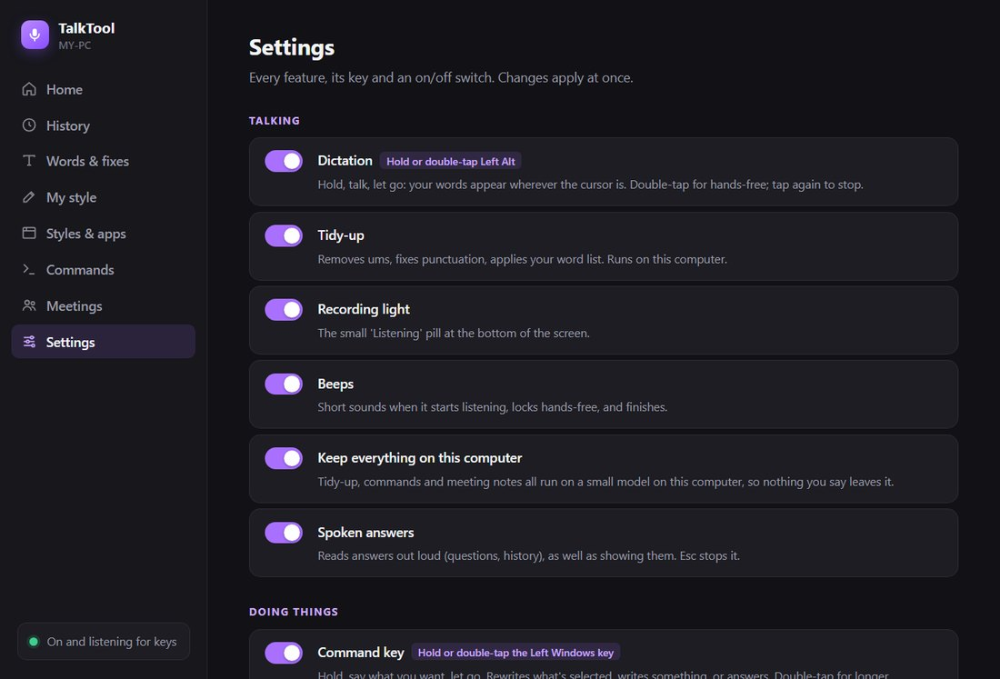
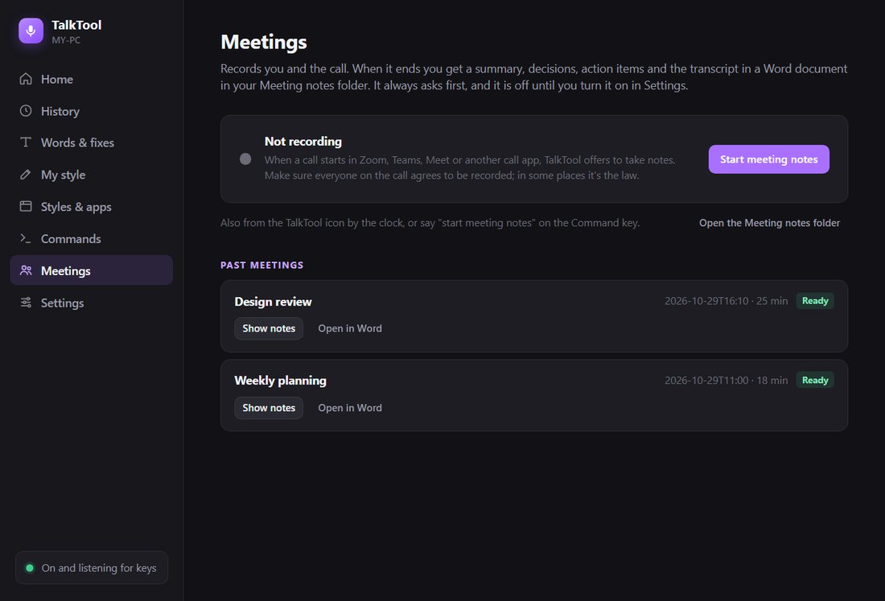
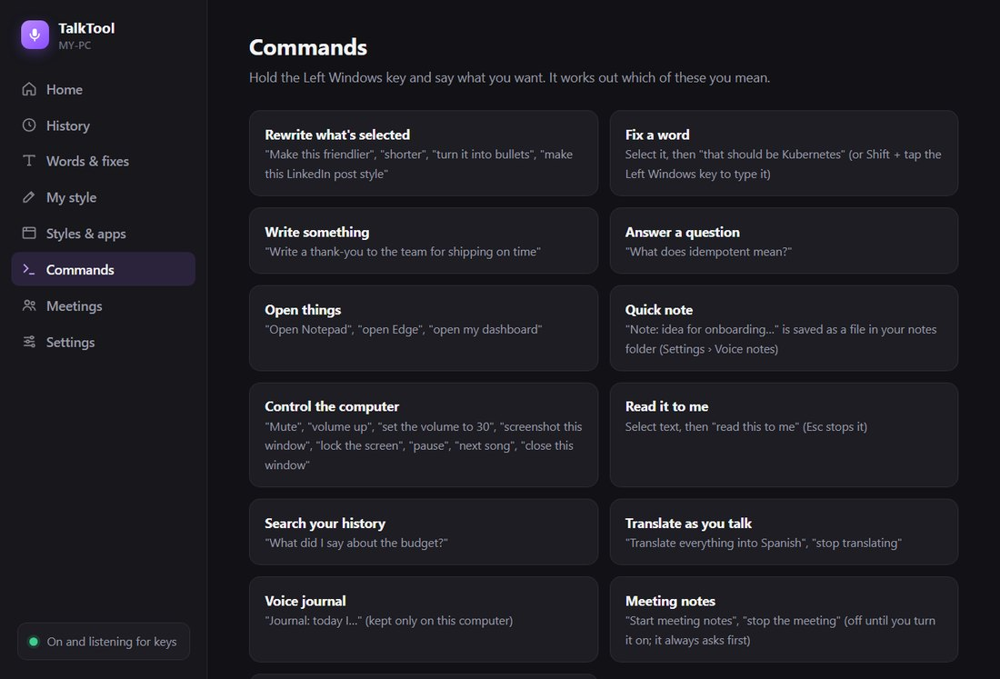
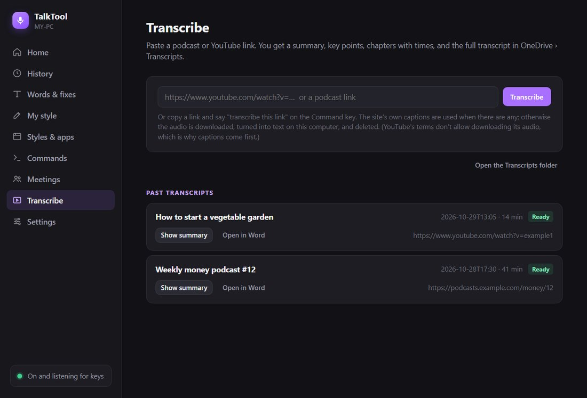
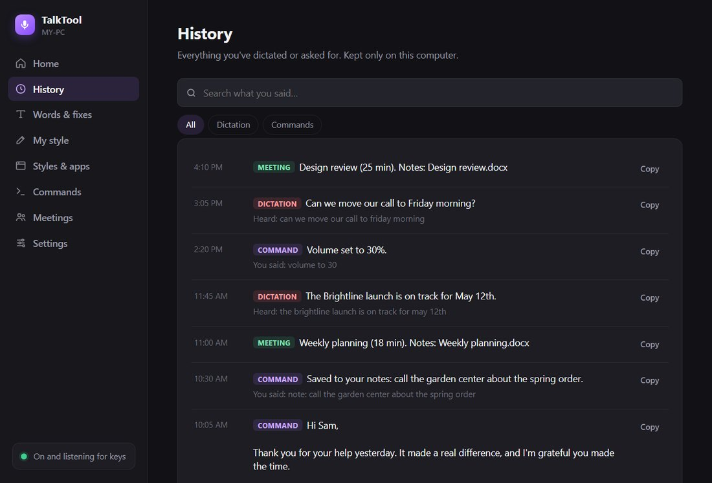

<p align="center"></p>

Hold a key, talk, and your words appear wherever your cursor is: in email, documents, chat, anywhere. Hold another key and tell it what to do: "make this friendlier", "write a thank-you note", "read this to me". You don't write any code. You paste one message to the AI, try what it builds, and tell it what happened. Everything runs on free AI models on your own computer.

| ⏱️ An afternoon | 💬 About a dozen | 💵 $0 | 🧑‍💻 No code |
|:-:|:-:|:-:|:-:|
| step by step, mostly waiting | short messages to send | beyond your AI plan | you write none of it |

> [!IMPORTANT]
> **Made with Claude Code, works with any AI app:** We built ours with Claude Code. You can use any AI coding app you like, for example Antigravity, Codex or Cursor: the messages and steps are the same. Section 3 shows where to paste the message in each.

**Contents**

1. [🎯 What you'll end up with](#1--what-youll-end-up-with)
2. [🧰 What you need](#2--what-you-need)
3. [🛠️ Get set up (10 minutes)](#3--get-set-up-10-minutes)
4. [🎨 Choose your options](#4--choose-your-options)
5. [💬 The one message that builds it](#5--the-one-message-that-builds-it)
6. [🧪 Try each step](#6--try-each-step)
7. [✨ Make it your own](#7--make-it-your-own)
8. [🩹 When something goes wrong](#8--when-something-goes-wrong)
9. [🛡️ Stay safe](#9--stay-safe)
10. [🎁 Give it to a friend](#10--give-it-to-a-friend)
11. [📖 Words you'll hear](#11--words-youll-hear)

## 1. 🎯 What you'll end up with

- **Dictation anywhere:** hold a key, talk, let go. Your words are typed with punctuation, and the "ums" are gone. "Thursday at 2, no wait, 3" comes out as "Thursday at 3".
- **A Command key:** rewrite selected text, write something new at your cursor, answer a question, or fix a word it got wrong.
- **It learns:** names and words it must spell right, and the mistakes you've corrected.
- **An app:** an icon by the clock, a Start menu entry, and a window with your history, your words and an on/off switch for every feature.
- **Extras you can pick:** meeting notes, "read this to me", quick notes, volume and music controls, opening files and apps, translating, and turning a YouTube or podcast link into a written summary.

<p align="center"><br><sub>What you'll have: your own app window, with your history, your words and a switch for every feature.</sub></p>

<p align="center"><br><sub>And a small light at the bottom of the screen whenever it's listening.</sub></p>

Building it takes an afternoon of mostly waiting. You'll send about a dozen short messages, or four if you let the AI build it all in one go.

## 2. 🧰 What you need

- **A Windows 10 or 11 PC** with about 6 GB of free space, and a microphone (a headset or USB mic works best; a laptop's built-in mic is fine).
- **An AI app that can build on your computer:** one that can create files and run programs for you, not just chat, for example Antigravity, Claude Code, Codex or Cursor. Any of them works; nothing here is tied to one. The AI does the building. Your AI plan is the only thing you pay for.
- A graphics card makes it faster, but you don't need one.

| Part of the app | What runs it | Cost |
|---|---|---|
| Turning your voice into text | A free speech model on your computer | $0 |
| Tidying text and understanding commands | A small free AI model on your computer | $0 |
| Keys, light, app window, everything else | Free tools the AI sets up | $0 |
| Optional: email drafts and calendar questions | Your AI plan, with Gmail or Outlook connected in your AI app's settings | Included |

> [!TIP]
> You never need a credit card, an API key or a cloud account. Your voice and words stay on your computer.

## 3. 🛠️ Get set up (10 minutes)

1. **Install your AI app** and sign in. Use one that can work on your computer, not just chat.
2. **Open the part of your AI app that can work on your computer.** It's like the chat you know, but the AI can create files and install things on your computer.
3. **Make an empty folder** for your app, for example `C:\TalkTool`, and pick it when your AI app asks which folder to work in.
4. **When the AI asks permission** to run something or download a model, read the one-line description and allow it. Each app asks in its own way: an Allow button, or a setting for how much it may do without asking. Allowing it for this folder is how it installs things for you.

Where to paste the message in some popular AI coding apps. Their menus change often, so look for the same idea if yours looks different.

| If you use | Open your folder | Paste the message into |
|---|---|---|
| Antigravity | Open the empty folder as your workspace | A new conversation or task with the agent |
| Claude Code | In the Claude desktop app, open the Code tab and pick the folder; or type `claude` in a terminal inside the folder | The chat box |
| Codex | In the Codex app, add the folder as a project; or type `codex` in a terminal inside the folder | The chat box |
| Cursor | File › Open Folder | The Agent chat in that same window |
| Something else | Any AI app that can create files and run programs in a folder on your PC | Wherever you talk to its agent |

## 4. 🎨 Choose your options

Decide these before you start. Changing them later works, but it means rebuilding parts. Write your answers into the [brackets] of the message in the next section.

| Choice | Suggested | Notes |
|---|---|---|
| Your app's name | TalkTool | Anything you like |
| Key to hold for dictation | Left Alt | Shortcuts like Alt+Tab keep working. Avoid Caps Lock. |
| Key to hold for commands | Left Windows key | Win+E and other shortcuts keep working |
| Your spelling and style | American English; no texting shorthand; contractions fine; friendly but professional | Say how you actually write |
| Words it must spell right | Your name, your company, product names | You can add more later |
| Which extras | All of them | Delete any build step you don't want |

<p align="center"><br><sub>Your writing style lives on its own page, so you can read and change it any time.</sub></p>

## 5. 💬 The one message that builds it

Change the [brackets], delete any build steps you don't want, and paste it into your AI app, in the part that can work on your computer. It answers every question up front, so the AI can just build. The same message is in [prompts/kickoff.txt](prompts/kickoff.txt).

```text
I want to build my own voice app for Windows called [TalkTool]: hold a key, talk, and my words are typed where my cursor is. I'm not technical and I've never coded. Build it step by step, show me something working after each step, and test what you can yourself before asking me.

FREE, ON MY COMPUTER
- Everything must run free on this computer. No paid services, no cloud accounts, no API keys, never ask me for payment details.
- First check my computer (graphics card, memory, disk space). Then pick the best free models for it, one to turn speech into text and one small AI model to tidy text and understand my commands, and download them from well-known, trusted sources. Tell me in one line what you picked and how big the downloads are.

KEYS
- Hold [Left Alt] to dictate: talk, let go, and the text is typed where my cursor is.
- Double-tap it for hands-free; tap once to stop. Esc cancels.
- Hold [Left Windows key] for the Command key: I just say what I want; double-tap it for longer instructions.
- Shift + tap the Command key opens a small box to type the right spelling of a word it got wrong.
- Both keys keep working normally in shortcuts (Alt+Tab, Win+E). Never Caps Lock.

TIDYING MY WORDS
- Keep my words. Remove ums, add punctuation, and apply "no wait" / "I mean" corrections. Never change days, names or numbers.
- My style: [American English spelling; no texting shorthand like "u"; contractions are fine; correct grammar; friendly but professional].
- When I tell the Command key what to do, my words are instructions: never paste them into the text.
- Words it must spell right: [my name, my company, product names].

BUILD ORDER (all of it by the end)
1. Dictation.
2. A small "Listening" light that never takes focus from my app, soft and quiet sounds (not loud beeps), and it starts when I sign in. If it can't hear me or something breaks, it tells me and fixes itself; it never fails silently.
3. Command key: rewrite selected text ("make this friendlier"), write at my cursor, answer questions, fix a misheard word ("that should be…").
4. Learning: a word list and fixes it remembers, which I can edit in the app.
5. The app: an icon by the clock, a Start menu entry, and a simple, good-looking window with Home, History, Words & fixes, Settings (an on/off switch and one-line explanation for every feature, showing each key) and Usage.
6. Meeting notes: records me and the call, offers to start when Teams or Zoom starts, reminds me to get everyone's OK, and saves a summary with action items as a Word document. It deletes the other people's audio afterwards.
7. More things to say: "read this to me", "note: …", mute, volume, pause, next track, lock, screenshot this window (a fixed safe list only), open files and apps, translate.
8. Link transcriber: a YouTube or podcast link becomes a document with a summary and timestamped chapters (use the site's captions first).
9. Optional, only if my AI app has Gmail or Outlook connected: email reply drafts and calendar questions. Drafts only, never send, never delete.

HOW TO WORK WITH ME
- Plain English, short answers. Pick sensible defaults and tell me what you picked; don't ask me technical questions.
- Short plan first, then build. No long research reports.
- If I mention a new idea, add it to the list instead of building it, unless I say "now".
- For big steps, build in a separate copy and swap it in only after your tests pass. Tests never take screenshots of my real screen, press real keys, change my volume, or send anything.

Start with step 1.
```

> [!IMPORTANT]
> **Want it all in one go?** Change the last line to: "Build all the steps without stopping. Test each one yourself, and only stop when everything works or you need a decision only I can make." Then come back in a few hours. That version is ready in [prompts/kickoff-all-in-one-go.txt](prompts/kickoff-all-in-one-go.txt).

## 6. 🧪 Try each step

After each step, try it with your real voice. If it works, just say **"Works. Next step."** If not, say what you did and what happened.

### Step 1 · Dictation

In Notepad, hold your talk key: "Testing one two three." Let go. Then double-tap, talk for 20 seconds, tap to stop. Check Alt+Tab still works.

<p align="center"><br><sub>While you hold the key, the light says "Listening".</sub></p>

### Step 2 · Light and start-up

Dictate into an email. The light shows "Listening", then "Writing…", and the text lands in the email.

<p align="center"><br><sub>When you let go, it says "Writing…" until the words land.</sub></p>

### Step 3 · Command key

Select a blunt sentence and say "make this friendlier". In an empty email, say "write a thank-you note to Sam for the help yesterday".

<p align="center"><br><sub>The Command key's light is purple, so you know which key is listening.</sub></p>

### Step 4 · Learning

Say your hardest word. Fix it once with Shift + tap the Command key. Say it again: it should come out right.

<p align="center"><br><sub>Your words and learned fixes, ready to edit.</sub></p>

### Step 5 · The app

Open it from the Start menu. Turn the sounds off and on. Pause it and check your keys act normally.

<p align="center"><br><sub>Every feature has a switch, its key and a one-line explanation.</sub></p>

### Step 6 · Meeting notes

A two-minute call with a friend (tell them you're taking notes). Agree on one task, hang up, open the notes.

<p align="center"><br><sub>Each meeting becomes a Word document you can open from here.</sub></p>

### Step 7 · More things to say

Select a paragraph: "read this to me". Then: "volume to 30", "pause the music", "open my downloads folder".

<p align="center"><br><sub>Everything you can say on the Command key, with examples.</sub></p>

### Step 8 · Link transcriber

Copy a YouTube link and say "transcribe this". Open the document.

<p align="center"><br><sub>Each link becomes a document with a summary and chapters.</sub></p>

## 7. ✨ Make it your own

Once it works, change anything by asking for it. Some starting points:

| You want | Say to the AI |
|---|---|
| A different key | "Change the dictation key to Right Ctrl. Keep normal shortcuts working." |
| It to write like you | "Here are three emails I wrote. Learn my style from them and use it when you write for me." |
| Different styles for different apps | "In Slack, keep it casual and short. In Outlook, use full sentences." |
| A new voice command | "Add a command: when I say 'start my day', open my email, my calendar and my notes." |
| Quieter or different sounds | "Make the sounds softer," or "turn the sounds off." |
| Fewer features | "Turn off meeting notes and hide it from the window." |
| A new look | "Make the window dark, with bigger text." |
| Your notes in a certain place | "Save my voice notes to the Notes folder in my Documents." |

> [!TIP]
> Ask for one change at a time, try it, then ask for the next. Say "build it in a copy and swap it in when the tests pass" for anything big, so the app you're using never breaks.

## 8. 🩹 When something goes wrong

Always tell the AI what you did and what happened, and ask it to read the log. It fixes most things in one message.

<p align="center"><br><sub>If it didn't hear you, the light says so for a moment instead of failing silently.</sub></p>

| What happens | Say to the AI |
|---|---|
| You talk, but nothing is typed | "I held the talk key in Notepad and nothing appeared. Read the log and fix it." |
| It stops responding to the keys | "The keys stopped working after a while. Find out why from the log, and make it recover by itself." |
| It says it can't hear you | "It says it didn't hear me, but my mic works in other apps. Check which microphone it's using." |
| It types your instruction into the text | "When I said 'make this shorter', it pasted those words. Commands must never be pasted." |
| Wrong spelling style (like "colour") | "Always use American English spelling, everywhere." |
| It changed a day, name or number | "I said Thursday and it wrote Friday. Never change days, names or numbers." |
| It's slow | "The first dictation after a break is slow. Keep the speech model warm." |
| A black window flashes up | "A black window flashed up while I was dictating. Make sure nothing shows a console window." |

## 9. 🛡️ Stay safe

- **Email is drafts only.** The app writes drafts; you read and send them yourself. Keep the "never send, never delete" rule.
- **Get everyone's OK before recording a meeting.** In many places recording people without telling them is against the law.
- **Your voice stays on your computer.** Recordings and history are saved only on your PC. Ask the AI to turn saving off or delete them any time.
- **Build big changes in a copy,** and keep a backup of your words and fixes before large changes.
- **Only download from trusted sources.** The message above tells the AI to use well-known sources for the models.
- **Respect sites' rules.** The link transcriber uses a video's own captions first.

<p align="center"><br><sub>Your history is kept only on your computer, and you can search it or turn saving off.</sub></p>

## 10. 🎁 Give it to a friend

When yours works, the AI can package a clean copy that a friend installs with one double-click. It contains none of your words, history or recordings. The same message is in [prompts/friend-version.txt](prompts/friend-version.txt).

```text
Make a friend version of my app that I can send as one zip. Build it in a separate copy and don't touch the app I use.
- None of my data: no words, fixes, style, recordings, history, logs, or my name or email anywhere. Search the whole copy to prove it's clean.
- Free and offline by default, using the same free models.
- One Setup file my friend double-clicks. It installs everything it needs (including Microsoft's Visual C++ Runtime if it's missing), shows a progress bar for the big download, resumes if the internet drops, adds a Start menu entry and starts at sign-in. Include an Uninstall too.
- The speech model goes inside the zip, so dictation works even if a download fails.
- A one-page "How to install" in plain words, and a credits file listing every part's license.
- Before you give it to me, install it from scratch in Windows Sandbox and check that it works there.
```

> [!NOTE]
> **What's Windows Sandbox?** Windows Sandbox is a clean, throwaway copy of Windows inside your PC: a perfect stand-in for your friend's computer. Turn it on under Start › "Turn Windows features on or off" › Windows Sandbox, then restart. Share the zip from Google Drive or OneDrive with just your friend's email.

## 11. 📖 Words you'll hear

- **Model:** The AI "brain" file. A speech model turns voice into text; a language model tidies and understands text. Free ones run on your own computer.
- **Runs locally:** On your computer, with nothing sent to the internet: free and private.
- **Hotkey:** The key you hold to talk.
- **Tray:** The icons by the clock, at the bottom right of Windows, where small background apps live.
- **Log:** A diary file the app writes as it works. When something goes wrong, the AI reads it to find out why.
- **AI coding app:** An AI app that can create files and run programs in a folder on your computer, for example Antigravity, Claude Code, Codex or Cursor.
- **Prompt:** A message you type to the AI.
