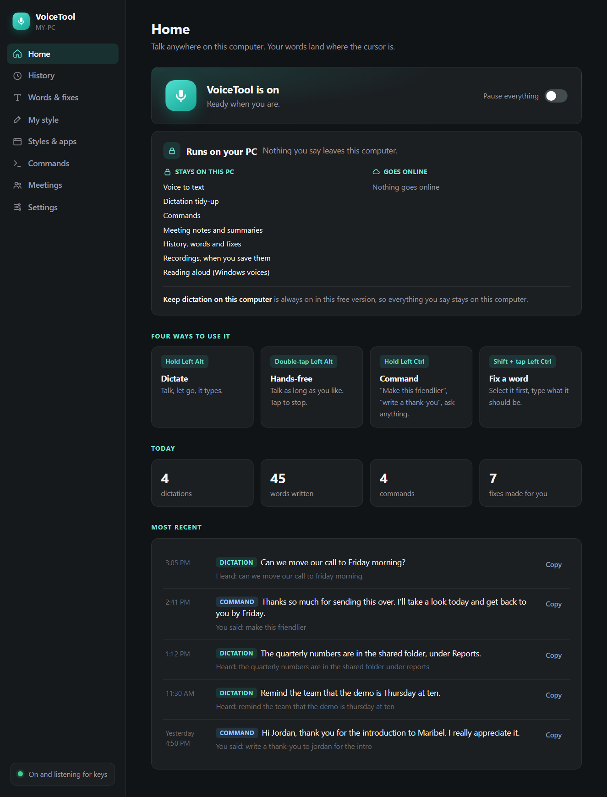

# Build your own voice app with AI

A free Windows app that lets you talk instead of type, anywhere. Hold Left Alt, talk, let go: your words land where your cursor is, with punctuation added and the "ums" gone. Hold Left Ctrl and tell it what to do: "make this friendlier", "write a thank-you note", "read this to me". It runs on free AI models on your own computer, so what you say stays there.

**You build it yourself, with AI, without writing any code.** This folder has everything you need: the step-by-step kit, every message to send, and the finished code to compare with or install directly. It's all open source.

> [!NOTE]
> **Made with Claude Code, works with any AI app.** We built ours with Claude Code. You can use any AI coding app you like, for example Antigravity, Codex or Cursor: the messages and steps are the same.

## Start here

1. **Read the kit:** [KIT.md](KIT.md), or the printable [PDF](docs/build-it-yourself-kit.pdf). It covers what you need, a 10-minute setup, your options, and every step. The kit calls the app you build TalkTool; name yours anything you like.
2. **Paste the kickoff message** from [prompts/kickoff.txt](prompts/kickoff.txt) into your AI app. Change the [brackets] first, and delete any build step you don't want.
3. **After each step, try it with your real voice.** If it works, say "Works. Next step." That's most of the conversation.

It takes an afternoon, mostly waiting. You need a Windows 10 or 11 PC with a microphone, and an AI app that can build on your computer: one that can create files and run programs for you, not just chat. **Any of them works**, for example Antigravity, Claude Code, Codex or Cursor. [KIT.md](KIT.md), section 3, shows where to paste the message in each. Nothing else to pay for.

## What's in here

| | |
|---|---|
| [KIT.md](KIT.md) | The build-it-yourself kit: setup, options, the steps, making it your own, fixing problems, staying safe |
| [docs/build-it-yourself-kit.pdf](docs/build-it-yourself-kit.pdf) | The same kit, ready to print |
| [prompts/](prompts/) | Every message to paste, as files you can copy, with [the order to send them](prompts/README.md) |
| [src/](src/) | The finished code of our copy, which we call VoiceTool. Compare it with yours, or install it directly |
| [tools/](tools/) | The tests our copy passed |
| [AGENTS.md](AGENTS.md) | Notes your AI app reads to set up, run and test the finished code (Codex reads it automatically; `CLAUDE.md` and `GEMINI.md` point other apps to it) |

Every lesson from our own build is already a line in the kickoff message, so your first try should go more smoothly than ours did.

## Install the finished code instead

Want to skip to the end, or see how yours compares? It needs **Windows 10 or 11 (64-bit)**, **about 6 GB of free space**, a microphone, and internet only while it sets up. Without a graphics card everything runs on the processor: **4 or more cores and 8 GB of memory** are recommended. 2 cores work, but give it a minute or two after it starts, and allow 20 to 30 seconds for a rewrite.

1. Download it from the [repository's main page](https://github.com/petercarter19-hue/Apps) (the green **Code** button, then **Download ZIP**). Right-click the zip, choose **Extract All**, and open the `voicetool\src` folder. (Setup doesn't work from inside the zip.)
2. **Double-click `Setup`** (the file named Setup.cmd). A window opens and shows what it is doing. Windows may ask first:
   - **Open File - Security Warning:** click **Run**.
   - **Windows protected your PC:** choose **More info**, then **Run anyway**.
   - On some Windows 11 PCs, **Smart App Control** can block Setup and say so. You can turn it off in Windows Security › App & browser control › Smart App Control settings, but Windows doesn't let you turn it back on without resetting the PC, so only do that if you're comfortable with it.
3. **Click Yes once** if Windows asks to install Microsoft's free **Visual C++ Runtime** (a clean Windows usually doesn't have it). The question can appear behind the Setup window.
4. **Wait,** and don't close the window until it says "VoiceTool is ready." It usually takes 20 to 45 minutes, mostly one big download. A small window with a progress bar may open for it and closes by itself when it says "All set".

What Setup downloads, each from its official source and checked against a fixed fingerprint (or Microsoft's signature):

| What | From | Size |
|---|---|---|
| The speech model (Parakeet TDT 0.6B v2, ONNX) | Hugging Face | about 660 MB |
| The tidy-up model (Qwen3 4B Instruct 2507, Q4_K_M) | Hugging Face | about 2.5 GB |
| The program that runs it (llama.cpp, graphics-card and processor builds) | GitHub | about 53 MB |
| Python 3.13, only if your PC doesn't have it, just for VoiceTool | python.org | about 30 MB |
| The Python packages VoiceTool uses, pinned to exact versions ([list](src/requirements-friend.txt)) | PyPI | |
| Microsoft Visual C++ Runtime, only if it's missing | Microsoft | about 25 MB |

VoiceTool goes into `%LOCALAPPDATA%\VoiceTool` (or `C:\VoiceTool` if your Windows user name has letters outside the English alphabet; Setup tells you). When it finishes, VoiceTool starts, beeps twice, and opens its window. It also starts each time you sign in.

**If something goes wrong, run Setup again.** It picks up where it stopped and never erases your words or settings. If the big download stops partway, open VoiceTool from the Start menu and click **Finish setup** on the Home page.

## Using it

- **Hold Left Alt**, talk, let go: your words are typed where your cursor is. **Double-tap** Left Alt to keep the mic on hands-free, and tap once more to stop. **Esc** cancels.
- **Hold Left Ctrl** and say what you want: "make this shorter" (with text selected), "write a thank-you note to Sam", "what does this mean", "open Notepad", "mute", "volume to 30", "read this to me", "note: buy milk", "journal: today I…". Double-tap it for a longer instruction. Ctrl still does its usual jobs (Ctrl+C, Ctrl+V, Ctrl+click, Ctrl+scroll): only Ctrl on its own is a command.
- **Fix a word:** select a word it misheard, then **Shift + tap Left Ctrl** and type what it should be. VoiceTool fixes it and remembers. Your learned fixes and the names it must spell exactly are on the **Words & fixes** page.
- **Meeting notes** are off until you turn them on in Settings. Each time, it asks you to make sure everyone on the call agrees to be recorded, then writes a Word document with a summary, decisions and action items. The other people's audio is deleted as soon as the notes are written.
- **Read aloud:** select text and say "read this to me". It uses Windows' own voices. Esc stops it.
- A small light at the bottom of the screen shows when it's listening. Soft beeps: higher means listening, a double beep means hands-free is on, lower means done.
- **The window** (Start menu, or the microphone icon by the clock) has Home, History, Words & fixes, My style, Styles & apps, Commands, Meetings and Settings, with an on/off switch and a one-line explanation for every feature.
- **Off until you turn them on:** meeting notes, spoken answers, saving recordings, and email and calendar drafts. Email and calendar drafts need an AI coding app on your PC that is signed in and connected to your mail ([AGENTS.md](AGENTS.md) says which); they only ever make drafts, and you press Send.
- **Not in this version:** transcribing YouTube or podcast links (the kit shows how to build it into yours).

**To remove it,** choose **Uninstall VoiceTool** in the Start menu. It asks whether to keep a copy of your words, fixes, style and history in `Documents\VoiceTool backup`, then removes VoiceTool, its start-up entry and its Start menu shortcuts. It doesn't touch your notes in Documents.

**Privacy:** your voice and your words stay on your computer. The internet is used only during setup, to download VoiceTool's parts. Your settings, words, fixes, style and history live in the VoiceTool folder; voice notes go to `Documents\Voice notes` and meeting notes to a `Meeting notes` folder in Documents, unless you choose another folder in Settings.

## How the finished code works

Python 3.13 on Windows 10 or 11 (64-bit), in its own private environment. Nothing is sent anywhere unless you turn on an online option.

- **`voicetool.py`** runs in the background: the keys (`pynput`), the microphone, the light and the tray icon. It turns speech into text with **Parakeet** through `onnx-asr`, then tidies it.
- **`local_cleanup_win.py`** runs the tidy-up model, **Qwen3 4B** in llama.cpp's `llama-server`, on this computer only (127.0.0.1). It uses the graphics card when there's one with enough memory, and the processor otherwise.
- **`commands.py`** handles the Command key: rewrite, write, answer, fix a word, open things, notes, translate, journal, meetings. **`system_actions.py`** is the fixed list of computer controls (volume, media, lock, screenshot of the window in front); nothing spoken is ever run as a command.
- **`corrections.py`**, **`spelling.py`** and **`styles.py`** keep your learned fixes, American spelling, and your writing styles per app.
- **`meetings.py`** records your mic and the call, and writes the notes with `python-docx`.
- **`app_window_win.py`** shows the window (`ui/index.html`) in Edge WebView2 through `pywebview`; **`ui_api.py`** is what the window can ask for.
- **`setup.ps1`**, **`fetch_models.py`** and **`uninstall.ps1`** install, download and remove it. Every Python package is pinned with its SHA-256 fingerprint in `requirements-friend.txt`, and every model file is checked against its own.

**Tests** (in `tools\`). They never press your real keys, take pictures of your screen, change your volume or send anything:

- `test_voicetool.py` and `test_app_window_e2e.py` (pytest) cover dictation, commands, learning, the window and meetings, in throwaway folders.
- `test_fetch_models.py` checks the downloader against a local test server.
- `test_setup_functions.ps1` and `test_uninstall.ps1` check Setup and Uninstall with throwaway folders and names.
- `dryrun_check.py` checks an installed copy end to end without touching the screen, keys or speakers.

[AGENTS.md](AGENTS.md) has the commands.

## License

[MIT](../LICENSE): use it, change it, share it. The speech model, the tidy-up model and the libraries VoiceTool uses keep their own licenses, listed in [src/THIRD-PARTY-NOTICES.md](src/THIRD-PARTY-NOTICES.md).
